<div align="center">

<h1>冒险的梦想家</h1>

<p><strong>把盘面、筛选和后续观察连起来的本地 A 股研究工作台。</strong></p>

<p>盘后看全局 · 用条件筛选 · 留下可复查的记录</p>

<p>
<a href="#界面预览">界面预览</a> ·
<a href="#开始使用">五步上手</a> ·
<a href="#主要功能">功能地图</a> ·
<a href="#ai助手直接提问继续研究">AI对话</a> ·
<a href="#工程亮点与性能优化">工程亮点</a> ·
<a href="#docker-安装">Docker 安装</a> ·
<a href="#文档导航">文档导航</a> ·
<a href="CHANGELOG.md">版本记录</a>
</p>

</div>

这个项目把日常复盘中分散的看盘、查题材、筛选和跟踪整合到一个工作台：先看市场与方向，再把观察写成规则，最后持续复查候选。行情、策略版本、运行结果、跟踪事件和自选记录保存在自己的实例中，可按日期、价格口径与来源证据回查。也可以在独立「AI助手」里直接提问，围绕系统已有盘面与个股资料继续多轮研究。

| 看清盘面                                           | 写清条件                                                   | 看见后续                                               |
| -------------------------------------------------- | ---------------------------------------------------------- | ------------------------------------------------------ |
| 在同一观察日查看指数、市场广度、行业题材和涨停梯队 | 个股与板块分别配置日 / 周 / 月规则，组合历史事件与今日条件 | 把候选加入跟踪或自选，复查触发事件、加入基准和后续涨幅 |

> **当前源码说明：v0.1.21／schema36**，新增自然多轮AI研究与固定前1000分类分布，见[版本记录](CHANGELOG.md)。源码能力、镜像发行与实例部署分别验收，本文不表示线上实例已经更新。下方Docker示例为v0.1.21配套安装，执行前须先核实 [v0.1.21标签](https://github.com/DreamerXX0301/ad-market-review/tree/v0.1.21)、[对应Release](https://github.com/DreamerXX0301/ad-market-review/releases/tag/v0.1.21)及镜像确已生成；文档列出配套地址不表示已经发布，旧镜像也不因README更新而获得AI功能。实际安装须核验所选版本的完整源码SHA、`release-image.json`与镜像摘要，已有数据先阅读[版本升级与回滚](docs/版本升级与回滚.md)。

本版包含原生服务辅助脚本`scripts/native_service.py`，支持启动、状态查询和安全停止，桌面可配置配套的启动与停止入口。它从私有部署控制文件读取已验收的独立版本，不将`master`应用源码直接作为现用服务，不安装依赖、迁移或重建数据。首次安装与升级仍需分别完成验收。详见[原生服务管理说明](docs/部署与运维.md#已有原生安装电脑重启后启动)。

## 近期新增与改进

0.1.21支持在「AI助手」自然提问、逐段流式阅读和继续追问；模型先理解股票研究任务，再按需读取六类本地资料。OpenAI固定提供八个常用模型，DeepSeek配置保留；Key逐模型验证后手动启用。近30日涨幅榜新增固定原始前1000样本的题材/行业Top5，页面与AI使用同一统计口径。0.1.19首次增加035/036两份AI迁移，当前数据库终点为schema36；0.1.20/0.1.21不再新增迁移。

此前0.1.18的生肖年度跟踪、搜索多选与粘贴名单、统一搜索、全池排序、滚动表头、概念浮层、午评联动和性能优化继续保留。0.1.18终点为schema34；从0.1.15/schema32升级时的033生肖表和034策略索引及其迁移SHA仍需完整保留。新安装三个计划默认关闭，已有自定义时间不覆盖；恢复副本关闭自动开关，验收后仅在唯一正式实例按明确授权开启。源码、镜像发行和实例部署分别留证。

| 能力                     | 现在可以做什么                                                                                                                                                                                            |
| ------------------------ | --------------------------------------------------------------------------------------------------------------------------------------------------------------------------------------------------------- |
| **自然多轮AI研究**       | 独立助手与盘面/个股快捷入口共用历史；支持盘面、竞价午评、涨停梯队、个股价量及经营估值，按真实语义选择只读资料，安全Markdown流式输出，输入框下方切换服务配置。 |
| **强势股分类分布**       | 按所选日原始近30交易日收益前1000固定取样，紧凑展示题材/行业Top5家数与占比；搜索、重排和分页不改变统计，多标签、未知及交易资格属性分别处理。 |
| **行业与概念联动**       | 同一入口切换概念、行业、涨跌、成交额、涨停活跃和近期活跃；点击名称看板块 K 线，点击行内其他位置看成员，宽屏左右独立滚动，窄屏上下展开。                                                                   |
| **已完成选股直接查看**   | 同一已发布行情日、相同实际配置和有效输入返回原结果，不新建任务或重复计算；涨停、年内计数或热点条件还会核对实际补充来源，输入变化后重新计算。批量操作只计算变化项。                                                                    |
| **午评与收盘回看**   | 午休手动或显式开启自动计划后采集，每天一次；冻结当时行情和观察，盘后追加同日收盘核验。午间/收盘涨幅分列，原关注支持板别、搜索与多条件排序；缺午评不补造。                                                                                |
| **盘前竞价与昨日对照**   | 数据中心统一开启每日固定09:25:30至09:30前的自动竞价，系统生成最多100只候选；可按昨日板高筛选及排序，昨日留存复盘、原主线与同股竞价并排核对，盘后再看同一名单的真实价格差；未就绪不采用旧数值。                                                      |
| **龙虎榜与买卖席位**     | 分开查看全部榜、机构榜和游资标签，区分单日与三日累计；点击整行展开并定位买卖前五席位，点击名称打开共用 K 线，代码单独复制。支持搜索清除、标签取消与完整结果排序；数据按30个市场交易日滚动留存。           |
| **可组合的技术选股**     | BOLL 收口与突破可配合放量、MACD、KDJ，参数自行调整；直接比较上一日 / 完整周 / 完整月的成交量。普通条件支持逐条件周期与嵌套组合，历史事件可绑定同一次事件的参照价；个股策略支持复制为新策略。              |
| **明确的复权与证据**     | 个股策略保存原价或本地前复权口径，技术指标和事件参照价使用同一锚点；旧规则、历史运行与入池基准保持冻结。涨停事实、原始涨幅与量能分别核验。                                                                |
| **市场情绪与反馈**       | 市场广度温度、阶段、指数环境和下一交易日条件计划集中呈现；区分趋势观察与短线接力。连板反馈概览包含已核验的昨日首板，完整明细保留昨日二板及以上。                                                          |
| **炸板结构与题材分布**   | 同源完整触板分母下观察收盘未封住比例、近7交易日和昨日炸板后续反馈；行业、概念按本批样本展示关联家数与平均涨跌，可与上市板块组合筛明细，价格正负反馈与涨停反包、跌停独立核验，历史归属不使用当前成员回填。 |
| **统一的看图与找股体验** | 个股、指数和板块共用单页日 / 周 / 月 K，初次进入或切换周期定位图表；支持滚轮 / 触控板缩放、高低涨幅、距图表截止日的交易日数、板型与事件标记。支撑、压力、事件标签移到右侧，支持单条与全部显隐。           |
| **题材与候选管理**       | 题材联合查股支持主板、创业板、科创板、北交所多选；策略、跟踪、自选支持近期热点筛选。概念关联顶部直接展示前20项涨停数量，卡片同排等高、定位避开固定栏。                                                    |
| **更清楚的更新流程**     | 盘后整链更新期间锁定业务操作，显示阶段、已用时和有依据的预计剩余，完成后确认解锁；同日同范围已完整成功的操作禁止重复创建，失败或部分完成仍可补齐。                                                        |

近30日涨幅榜默认查看前100名，也可选择前200/300/500/1000或全市场，并支持全市场搜索；上方分类分布始终采用原始前1000样本，未排名股票另列基准缺失等原因。当日重点主线按来源线索归组，无需逐日补录。独立“资金与轮动”入口已归并至行业与概念，不稳定的行业资金趋势停止展示与新任务采集，旧证据保留。具体交互见[盘面使用与数据核验](docs/盘面使用与数据核验.md)。

## AI助手：直接提问，继续研究

在「数据源 → AI模型」配置自己的DeepSeek或OpenAI Key，保存、验证并手动启用后，从导航进入「AI助手」。盘面和个股研究页的「问AI」快捷入口进入同一工作台，携带观察日或证券作为起点。宽屏左侧历史、右侧对话；输入框及模型切换位于底部，无须选择“本地资料/联网”或先生成固定报告。

可以问“今天行情有哪些变化”“最高连板是谁”“这只股票这一天成交多少”“近30日涨幅前1000集中在哪些题材”，再继续问“这个题材有哪些股票”或“明天需要验证什么”。助手先理解完整语义，在程序核验后按需读取系统资料；股票影响或经营问题也不必套固定句式。日期、股票和话题可以明确切换，旧回答不会被改写。

回答逐段显示，支持标题、列表、表格和来源；输出时跟随到底，上翻阅读后暂停，可点「回到最新」。停止可留下未完成片段，断线重连只续读已有流，不重复生成。正文完成与费用结清是不同状态，usage或搜索费用仍待核时会保留待核记录，不当成供应商实际扣款。历史默认30天，可手动保留；读历史不再调用模型。

AI只做A股盘面与上市公司研究，不运行SQL、改策略或下单。未到时点、未采集、未知、本轮未读取会分开说明；成交额不当净流入，没有真实盘中时序就不编造资金轮转。自动联网目前只接通OpenAI `gpt-6.1-sol`的一次受限搜索；八模型可配置不代表都已接通搜索或账号均有权限。一问通常需要2至3次模型请求，验证也可能计费，实际额度由实例设置控制。

[使用与配置](docs/AI研究与复盘使用说明.md) · [每步执行流程](docs/AI对话执行流程.md) · [架构与成本边界](docs/AI模型接入与研究试点设计.md) · [前1000统计契约](contracts/gainers-distribution-v1.md)

## 界面预览

下方流程图展示已实现的操作流程与数据边界，属于原创功能示意，未使用真实行情数值、私人会话或验收截图，也不代表某版本镜像已经发行。更详细的页面操作见[界面导览](docs/界面导览.md)。

### 01 · 从盘前定价，到午间观察，再到盘后复查

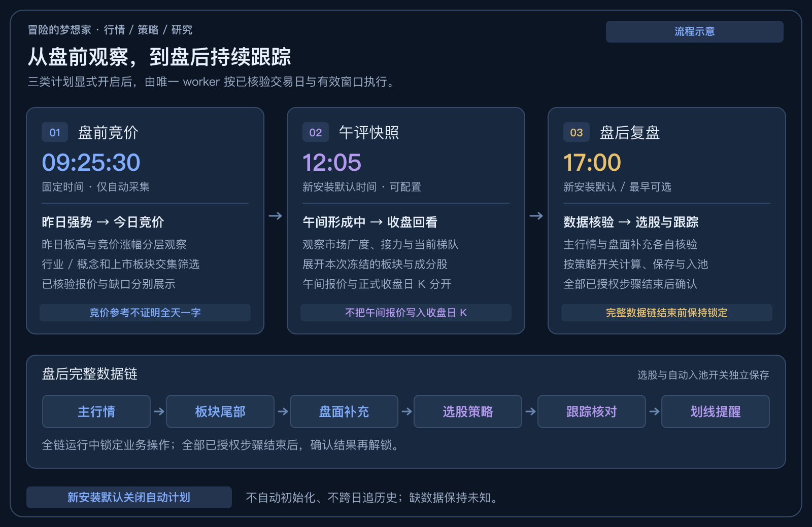

| 阶段 | 主要看什么 | 运行边界 |
| --- | --- | --- |
| **盘前竞价** | 昨日首板 / 连板 / 炸板背景、竞价涨幅与价量、行业和概念的样本反馈 | 显式开启后固定09:25:30自动触发，09:30前有效；不手填采集名单，不在开盘后补造竞价。 |
| **午评快照** | 同份午间快照中的方向、成员报价与观察名单；盘后再对照午间至收盘的变化 | 午评默认12:05，每天一次；形成中报价独立保存，不写入正式收盘日K。 |
| **盘后更新** | 主行情、板块尾部和盘面补充发布后，再核验策略、跟踪和划线提醒 | 默认及最早17:00；整条数据链运行时锁定业务操作，全部结束后确认结果再解锁。 |

新安装的三个自动计划默认关闭；已有自定义时间不覆盖。显式开启后由唯一worker在已核验交易日与有效窗口内执行，电脑与服务需要保持运行，浏览器可关闭。时间是计划触发点，不代表数据会在该秒采集完成。[自动采集计划说明 →](docs/自动午评与盘后复盘.md)

### 02 · 从一条选股规则，到可复查的结果

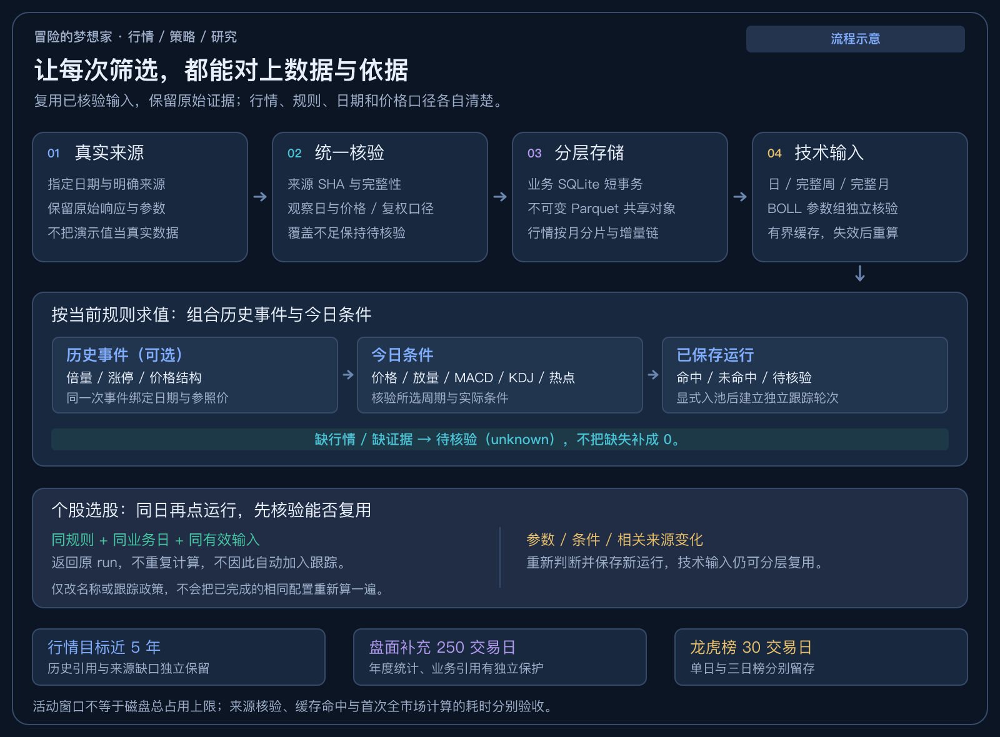

历史事件与今日条件分别配置，BOLL、量能、MACD、KDJ可以组合，日 / 完整周 / 完整月按各条件核验。相同行情日、相同配置与有效输入直接读取已保存结果；参数、相关来源或行情代际改变后重新判断。只改名称、跟踪期限不会触发重算。

筛选与加入跟踪是独立动作。盘后开启“同步完成后重新筛选”、关闭“命中新股自动加入此策略跟踪池”，即可只保存结果；需要跟踪时再明确加入。历史运行保留当时的规则、价格口径与输入依据，缺失继续显示待核验。[选股复用与同步后执行 →](docs/盘面使用与数据核验.md#个股选股直接复用今日结果)

### 03 · 同一个对象，在各页面保持一致

| 入口 | 点击后可以做什么 |
| --- | --- |
| **行业与概念** | 点名称查看板块K线；点行内其他位置展开成员。左右列表独立滚动，成员可按主板、创业板、科创板、北交所筛选。 |
| **龙虎榜** | 点整行展开并定位买卖席位；点股票名称看共用K线。单日、三日披露及机构、游资标签分开查看。 |
| **市场情绪** | 沿页内目录查看市场读数、指数环境、次日条件计划、炸板结构、连板反馈和广度历史；行业 / 概念均幅按当前股票样本计算。 |
| **个股、指数与板块K线** | 打开或切换周期后定位图表，滚轮 / 触控板缩放；成交量、BOLL、KDJ、MACD同屏查看，资料保留在上方。 |
| **跟踪与自选** | 保留加入基准，按热点与归属筛选；跟踪支持多条件排序。点击股票沿当前列表连续看图，代码单独复制。 |

### 04 · 从一个问题，到可继续追问的回答

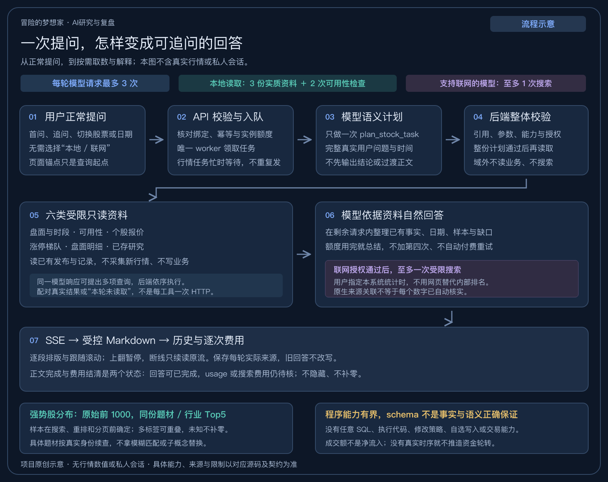

一轮最多3次模型请求；首个计划可以同时提出多个只读查询，后端按3份实质资料＋2次可用性检查的预算执行，并不为每个工具单独增加一个模型HTTP。确需外部资料且模型支持时最多一次受限搜索；schema合规不保证语义或事实永远正确。图中没有真实行情或私人会话，[每一步的作用与边界 →](docs/AI对话执行流程.md)

<details>
<summary><strong>历史界面截图 · 拍摄于2026-10-21，部分菜单与布局早于当前版本</strong></summary>

以下截图来自独立展示环境，使用当时已留存行情与示例操作，未包含日常使用实例的私人策略、数据库、凭据或原始包。它们用于了解早期界面风格；当前菜单、自动计划和图表交互以本页说明及界面导览为准。

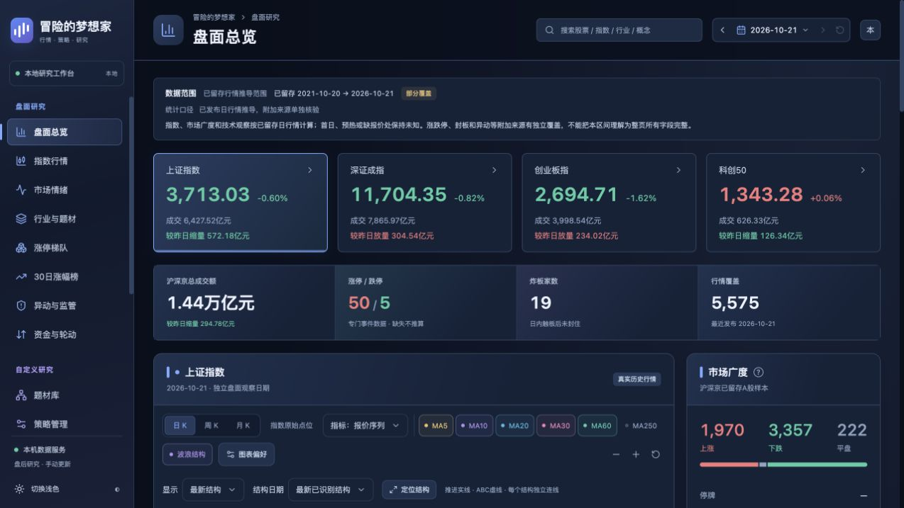

<table>
  <tr>
    <td width="50%"><a href="docs/images/strategy-editor.jpg">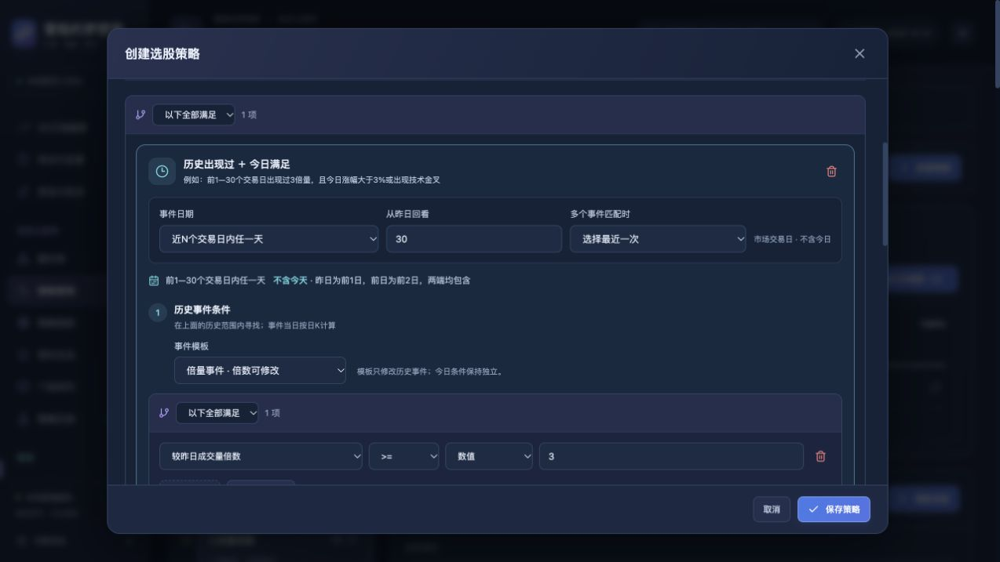</a></td>
    <td width="50%"><a href="docs/images/strategies.jpg">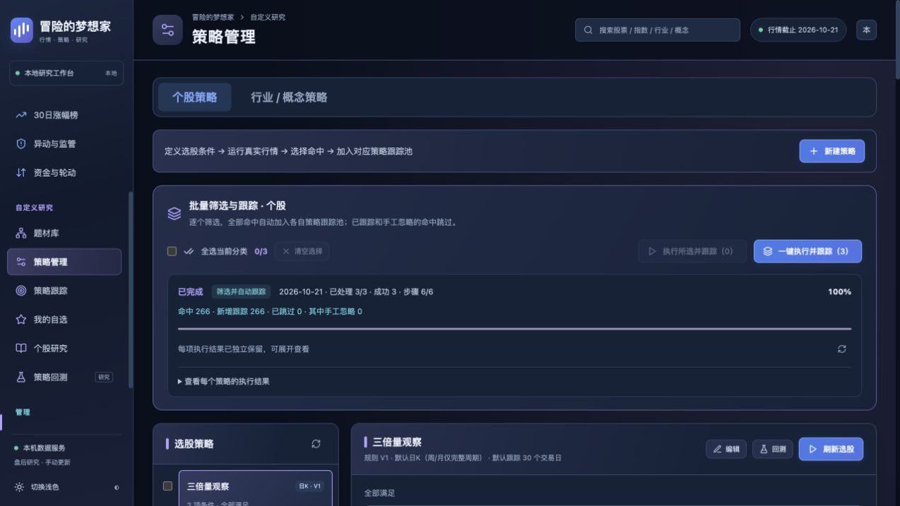</a></td>
  </tr>
  <tr>
    <td width="50%"><a href="docs/images/stock-chart.jpg">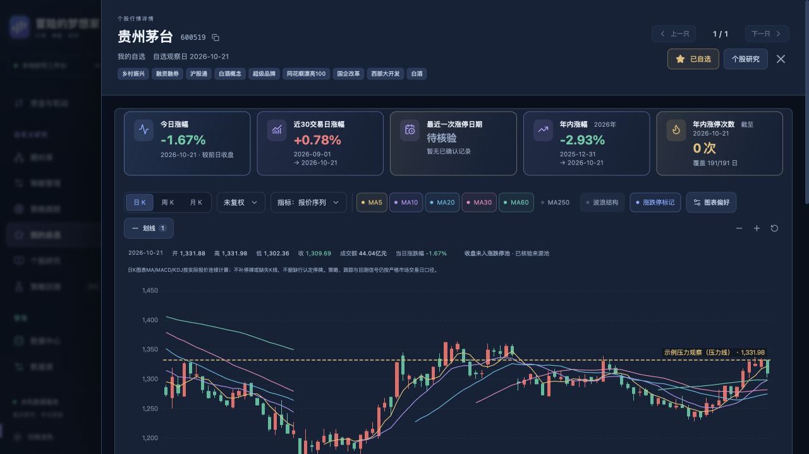</a></td>
    <td width="50%"><a href="docs/images/watchlist.jpg">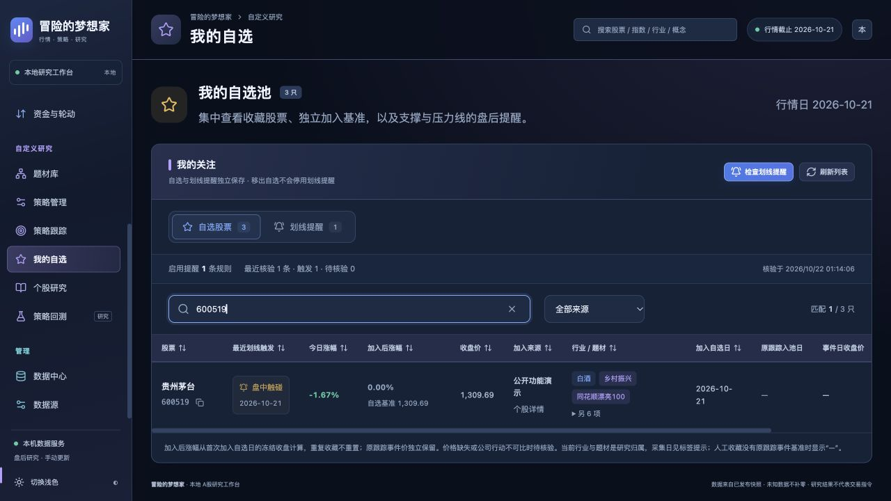</a></td>
  </tr>
  <tr>
    <td width="50%"><a href="docs/images/data-coverage.jpg">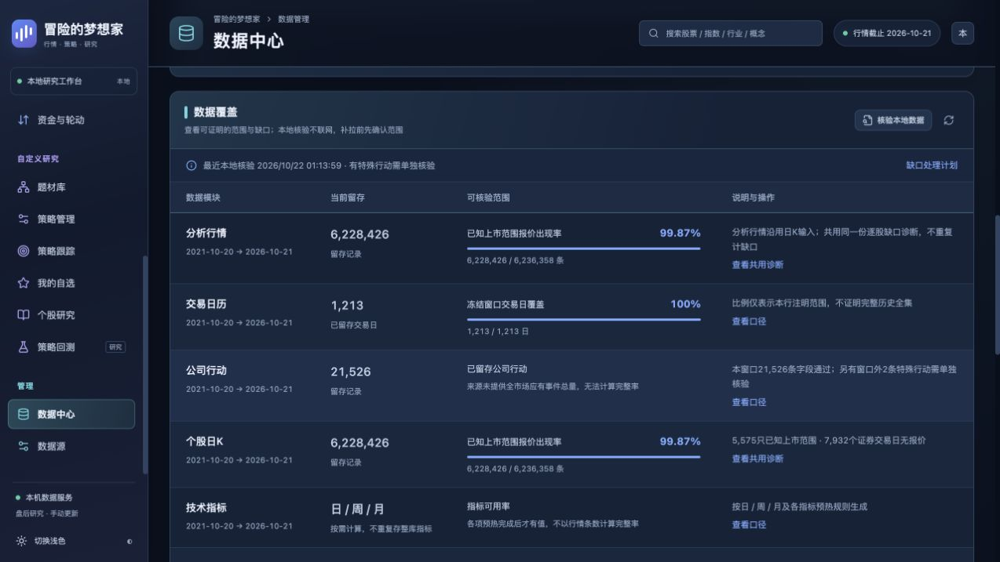</a></td>
    <td width="50%"><a href="docs/images/overview-light.jpg">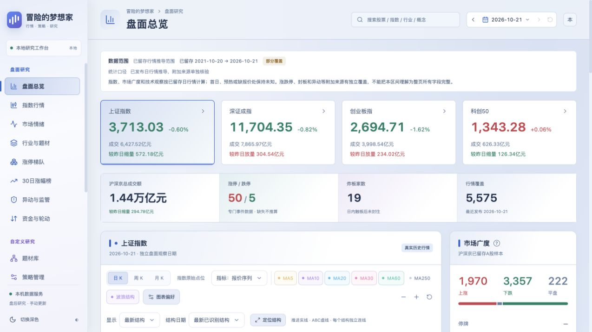</a></td>
  </tr>
</table>

</details>

流程图可编辑源码：[日常复盘](docs/diagrams/daily-review-workflow.svg) · [策略与证据](docs/diagrams/strategy-evidence-flow.svg) · [AI对话](docs/diagrams/ai-research-flow.svg)。

## 开始使用

完成安装后，按这五步建立自己的研究流程。

| 步骤                  | 在哪里操作                                                      | 会留下什么                                |
| --------------------- | --------------------------------------------------------------- | ----------------------------------------- |
| **1. 接入数据**       | 在「数据源」填写自己的 Key，逐项验证行情、板块和成员等实际能力  | 当前来源可用范围与验证结果                |
| **2. 建立本地窗口**   | 在「数据中心」手动初始化，默认目标近五年，再查看各模块覆盖      | 已发布行情、分类成员、板块 K 线与缺口说明 |
| **3. 选择研究对象**   | 在盘面、行业与概念、涨停梯队或全局搜索中打开股票与板块            | 对应观察日的图表、行情摘要与来源说明      |
| **4. 执行自己的规则** | 选择个股或板块策略，配置条件，执行所选或全部策略并跟踪          | 策略版本、筛选结果与各自独立的跟踪轮次    |
| **5. 更新并复查反馈** | 北京时间17:00后手动或显式启用自动盘后计划（默认17:00），再查看跟踪、自选与划线反馈 | 后续变化、触发事件和可复查的价格依据      |

在「数据中心 → 自动采集计划」统一保存竞价、午评和盘后三个独立开关；竞价固定09:25:30，午评默认12:05，盘后最早17:00、默认17:00。新安装默认关闭；恢复副本同样关闭并保留原计划时间与历史回执，验收后在唯一正式实例重新明确开启。[自动午评与盘后复盘](docs/自动午评与盘后复盘.md)、[盘前竞价](docs/盘前竞价.md)分别说明时间窗和来源边界。

板块首次全库 K 线完成后，日常更新只追加尾部。新盘后链在数据核验发布后，才按各策略“同步完成后重新筛选”与“自动加入跟踪池”的独立开关执行；不勾选入池也可只保存筛选结果。完整结果仍需确认解锁，暂停或取消不自动继续。盘面观察日期与策略、跟踪、研究、回测的日期分别管理，切换盘面日期不会改写业务记录。

已有原生安装重启电脑后，双击部署时生成的桌面启动入口；只关闭网页时服务仍可运行，无需反复启动。服务常开且已明确开启计划时，关闭浏览器不影响自动检查，关机则不能采集。原生与Docker是独立运行方式，不能同时挂同一份业务数据；详见[日常启动与状态核对](docs/部署与运维.md#已有原生安装电脑重启后启动)。

## 主要功能

| 你想做什么             | 工作台入口            | 主要能力                                                                                                                                        |
| ---------------------- | --------------------- | ----------------------------------------------------------------------------------------------------------------------------------------------- |
| 通过自然对话继续研究   | **AI助手**            | 从盘面/个股进入同一历史，按语义查询已有盘面、梯队、价量及研究；安全Markdown流式回答，支持追问、停止和断线续读，模型设置在底部                   |
| 从市场找到研究方向     | **盘面研究**          | 沪深广度温度与阶段、下一交易日条件计划、指数 / 广度 / 昨板价格反馈三轴对照；统一连板高度、板型与量能，自动只读主线及手动留存复盘                |
| 浏览方向并展开关联股票 | **行业与概念**        | 行业/概念与多种榜单集中切换；名称看 K 线、行内其他位置看成员，独立滚动、板别筛选、历史名单和报价覆盖分别核验                                    |
| 留存上午盘面并对照复盘 | **午评快照**          | 午休手动或显式启用自动计划后每天一次；午间/收盘涨幅分列，同份快照的板块成员使用午间报价，名单日与报价时点分开；盘后核验不改午间事实，正文保留28自然日           |
| 核对昨日关注的开盘定价 | **盘前竞价**          | 昨日原判断、终态价量与开盘观察同屏，最多100只；数据中心开启后服务固定09:25:30自动采集，无单次/手填名单；昨日板高与行业概念可组合筛选，采集中显示进度，盘后同名单核对                             |
| 查看公开榜单资金证据   | **龙虎榜**            | 单日 / 三日、机构与游资标签分开，买卖前五席位、来源原因、排序与代码复制；与盘面共用观察日                                                       |
| 对照价格与事件         | **图表与全局搜索**    | 单页日 / 周 / 月 K与成交量、BOLL、KDJ、MACD；按绘图区宽度自适应初始窗口，保留完整已加载历史与手动缩放；高低涨幅、紧凑头部、已核验板型与事件标记 |
| 整理自己的分类         | **题材库**            | 行业 / 题材交并集查股、上市板块筛选、成员排序、人工纳入与排除，保留归属修订记录                                                                 |
| 把思路变成筛选条件     | **策略管理**          | 个股与板块独立策略，嵌套全部 / 任一条件、逐条件周期、BOLL与量能、历史事件、批量执行与个股策略复制                                               |
| 看候选后续怎样变化     | **策略跟踪**          | 默认30个市场交易日，独立提醒与结束规则，热点归属筛选、板别/名称查询、多条件排序、当日 / 跟踪涨幅、触发事件和历史轮次                                                       |
| 留下主动观察的标的     | **我的自选**          | 从详情、跟踪或成员列表收藏；热点归属筛选，保留首次加入日、独立基准、原跟踪来源与划线记录；顶部今日提醒数量与历史查询分开                                                        |
| 围绕单个标的查资料     | **个股研究**          | 六区证据报告：主营构成、财务估值、公告线索、日周月强弱与相对指数、已确认技术位；机构与社区原文入口                                              |
| 在受支持样本内检验条件 | **策略回测**          | 个股独立区间、统计、权益 / 回撤，以及交易、订单、成交与持仓记录；运行前检查条件与数据是否可用                                                   |
| 复查异动与监控名单     | **异动与监管**        | 最新已留存名单与指定日历史分开，名单观察日和行情日独立；供应商标签与官方监管原文区分                                                            |
| 确认数据能解释到哪里   | **数据中心 / 数据源** | 手动同步与任务历史、整链进度、本地覆盖核验、证券名录与上市身份、逐股报价缺口诊断和显式来源核验                                                  |

自选与策略跟踪各有自己的基准；重复收藏不重置首次加入价。展开板块成分股只供浏览，不会自动创建个股跟踪或套用板块事件价。

市场情绪用页内目录定位指数环境、计划、短线接力和来源；完整统计与个股观察名单默认展开。操作状态采用禁止红色、有条件绿色、等待黄色、未知灰色，股票涨跌及晋级反馈沿用涨红跌绿。下一交易日计划由已留存盘后证据生成，未来条件仍须验证；不将一次放量直接认定为底部。连板反馈按已核验昨日高度降序，缺证据保留未知。详见[市场温度与下一交易日计划](docs/市场温度与下一交易日计划.md)及[连板高度、板型与反馈](docs/连板高度板型与反馈.md)。

## 工程亮点与性能优化

性能处理覆盖计算、存储和页面读取，重点减少同一份数据的重复准备，同时保留收益、指标、候选依据和未知状态的对账。

| 场景                         | 已实现的处理                                                                                                                                                | 生效边界                                                                                                                    |
| ---------------------------- | ----------------------------------------------------------------------------------------------------------------------------------------------------------- | --------------------------------------------------------------------------------------------------------------------------- |
| **同日相同策略再次点击**     | 核验行情、规则及实际补充池SHA；稳定输入直接返回原run，后续年内池或热点依据发布变化则重新计算。正文核验在写事务外，暖命中仍检查实际文件身份。                         | 合法覆盖缺口仍逐股待核验，不填零；原请求标识保留原冻结结果，新请求按当前输入判断。结果复用不自动加跟踪。                 |
| **换策略、微调参数再运行**   | 分层复用经来源核验的日 / 完整周 / 完整月技术输入、历史事件尾部和同参数 BOLL 计算；BOLL 参数变化时从严格输入重算对应参数组，修改规则后重新求值并保存新运行。 | 缓存有容量、来源与算法版本约束；更长历史窗口、新字段或证据变化可能重新准备，不复用旧命中名单。                              |
| **首次选股计算**             | 唯一 worker 可按需启动最多4个纯计算子进程，按有界批次准备输入；父进程保持原顺序求值与落库。                                                                 | 子进程不联网、不打开业务或分析数据库、不写缓存；支持 `SHIXU_SELECTION_CPU_WORKERS=0..4`，小任务及不满足条件的输入走原路径。 |
| **保存结果、跟踪与自选浏览** | SQL 只物化所选结果分类，跟踪列表使用必要字段摘要，完整详情按需加载；高频读取批量投影，离开的页面停止轮询。                                                  | 政策、事件和题材归属仍重新核验；同范围刷新保留已有行，切换范围重新读取。                                                    |
| **个股 / 板块图表与盘面**    | 复用固定行情代际的有界报价和来源摘要，浏览器按需计算已启用的 BOLL 与波浪叠加；近30日榜按所需窗口批读，避免逐股展开五年历史。                                | 首次加载和完整证据核验仍有成本；历史缺口与预热不足不以缓存补造。                                                            |
| **板块尾部增量**             | 仅请求已验收尾部之后的缺少交易日，任务内复用来源连接与规划，并预热可丢弃的本地指标摘要；新任务在本次板块尾部批次内采用0.6秒串行请求发起间隔。               | 来源请求仍串行、受权限和限流约束；旧冻结任务保持原政策，网络耗时不等于本地计算耗时。                                        |
| **存储与升级**               | 主行情使用不可变 Parquet 共享对象与增量链，盘面补充引用可复用对象；独立恢复后切换版本，常规只保留一套已验证的压缩完整恢复集。                                   | 新恢复集验收前保留上一套；活动窗口、物理文件与业务引用分别管理，有引用的证据不能按目录年龄删除。                            |

验证区分首次准备、重复运行、换规则、参数调整和重启，并比较完整结果、来源 SHA、排序与缺失原因。部分首访仍需秒级或更长时间，不能把局部暖缓存收益宣传成全链路耗时。详细实现与实测条件见[日期切换、选股与浏览性能](docs/日期切换与选股性能.md)和[存储与盘后增量优化](docs/存储与盘后增量优化.md)。

### 怎样验证这些改动

[v0.1.15发行工作流](https://github.com/DreamerXX0301/ad-market-review/actions/runs/40868412343)完成后端 **6,248项通过、3项跳过**，前端 **166个测试文件通过**，并构建、核验amd64与arm64镜像。测试数量只对应这次固定发行提交，跳过原因与各项环境以工作流日志为准；后续源码检查见[Source checks](https://github.com/DreamerXX0301/ad-market-review/actions/workflows/ci.yml)。

发布前还要在独立副本核对SQLite结构与业务事实、行情和原件SHA、凭据可用性及唯一worker。缓存优化比较完整结果与缺失原因，分别记录首次准备、重复读取和变更规则的耗时；不把暖缓存速度当成首次全市场计算速度，也不把来源历史覆盖不足算成完整数据。可复查的边界见[交付与验收](docs/交付与验收.md)。

## 数据如何流转

你决定何时手动取数、启用当日自动计划和运行研究。唯一 worker 处理任务、核验并发布本地数据，页面读取已经发布的结果。

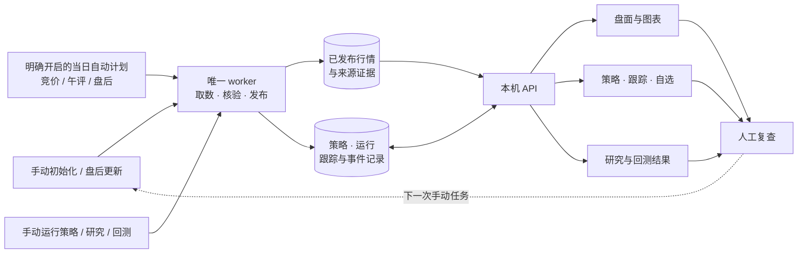

行情快照与业务记录分开保存，策略编辑与收藏等操作通过 API 保存业务记录。已完成运行保留当时的策略版本和输入依据，后续数据更正不会悄悄改写旧结果。来源验权与手动取数会连接对应供应商，本地存储并不代表所有操作都离线。

## Docker 安装

需要 Docker Engine / Docker Desktop 和 Compose。**本段为0.1.21配套安装示例；请先核实对应正式Release附件与镜像已经生成，再执行下载和启动，本文不保证它们已发布。** 以下流程使用 `ghcr.io/dreamerxx0301/ad-market-review:v0.1.21`，只下载配套部署文件并拉取镜像，无需在本机构建；执行前核对上方发行记录中的镜像可用性、实际摘要及配套源码标签。已有安装请先看[升级与回滚](docs/版本升级与回滚.md)。

源码仓库及已公开的Release附件可匿名下载，镜像也允许匿名拉取；不要求GitHub登录。以下使用 `curl` 获取配套[0.1.21 Release附件](https://github.com/DreamerXX0301/ad-market-review/releases/tag/v0.1.21)，须先确认本版已正式发布。已持有配套源码时，也可复制其中的 `deploy/docker-compose.yml`。下载前检查同名文件，已有文件时先核对版本或使用新目录；已安装并配置GitHub CLI时，也可选用 `gh release download v0.1.21 --repo DreamerXX0301/ad-market-review --pattern docker-compose.yml` 作为便利下载方式。

```bash
mkdir ad-market-review
cd ad-market-review

test ! -e docker-compose.yml && test ! -L docker-compose.yml && \
  curl --fail --location --output docker-compose.yml \
  'https://github.com/DreamerXX0301/ad-market-review/releases/download/v0.1.21/docker-compose.yml'
docker pull ghcr.io/dreamerxx0301/ad-market-review:v0.1.21

umask 077
key_dir="$HOME/.local/share/ad-market-review-secrets"
mkdir -p -m 700 "$key_dir"
docker run --rm --user 0:0 --network none \
  --mount "type=bind,src=$key_dir,dst=/secrets" \
  --entrypoint python ghcr.io/dreamerxx0301/ad-market-review:v0.1.21 \
  /app/deploy/create_secret.py /secrets/master.key
export SHIXU_MASTER_KEY_FILE="$key_dir/master.key"
export SHIXU_IMAGE_REF=ghcr.io/dreamerxx0301/ad-market-review:v0.1.21
export SHIXU_HTTP_PORT=8788

docker compose -p ad-market-review -f docker-compose.yml pull
docker compose -p ad-market-review -f docker-compose.yml up -d api
```

打开 [http://127.0.0.1:8788](http://127.0.0.1:8788)，确认页面正常后启动唯一 worker：

```bash
docker compose -p ad-market-review -f docker-compose.yml --profile worker up -d worker
```

服务只绑定本机。若8788已有实例，请使用新的安装目录、项目名及空闲端口，不共享现用数据卷。主密钥单独保存，恢复旧凭据必须使用原主密钥。需要固定镜像摘要时可通过 `SHIXU_IMAGE_REF` 覆盖默认镜像；更新实例按 `compose.release.yaml` 的摘要流程进行。完整安装和配置见[Docker部署](docs/Docker部署.md)，备份与进程管理见[部署与运维](docs/部署与运维.md)。

## 源码运行与开发

需要当前源码功能时，在本地检出项目后运行。环境要求：Node.js 22.12+、npm、uv、Python 3.13–3.14；Python 的 SQLite 运行库须通过程序版本检查。

```bash
./scripts/dev.sh
```

脚本安装锁定依赖、检查并执行数据库迁移、构建前端，再启动 API 与单个 worker。它适合首次安装和开发；已有业务数据请按[升级与回滚](docs/版本升级与回滚.md)在独立恢复副本验证。

| 源码位置                                                                 | 对应内容                         |
| ------------------------------------------------------------------------ | -------------------------------- |
| `frontend/src/features/market`                                           | 盘面、图表入口与成员浏览         |
| `frontend/src/features/strategies` / `sector` / `tracking` / `watchlist` | 个股与板块规则、跟踪及自选       |
| `frontend/src/features/data` / `sources`                                 | 数据覆盖、任务与来源配置         |
| `frontend/src/features/ai`                                               | AI工作台、历史、配置与流式阅读    |
| `backend/app/services`                                                   | 数据、策略、跟踪与研究等业务流程 |
| `backend/app/analytics` / `infrastructure`                               | 指标与回测计算、存储和发布       |
| `contracts` / `backend/tests`                                            | 接口契约、数据结构与检查         |

前端使用 React / TypeScript，后端使用 FastAPI；业务记录保存在 SQLite，行情与分析使用 DuckDB / Parquet。开发约定和检查入口见[贡献指南](CONTRIBUTING.md)、[前端说明](frontend/README.md)与[架构文档](docs/架构与模块边界.md)。

## 数据留存与使用边界

初始化与个股研究由用户手动发起；盘后增量可手动发起，或由明确开启的当日自动计划创建。竞价仅按每日自动计划执行，午评同时支持手动与明确启用的自动计划；页面浏览读取本地已发布数据，不因打开页面自动补采行情。来源能力验证和手动采集仍需联网，暂停、取消的任务不会自行继续。

| 数据                         | 窗口与清理方式                                                                                                                                 |
| ---------------------------- | ---------------------------------------------------------------------------------------------------------------------------------------------- |
| **个股、指数与板块 K 线**    | 默认目标近五年活动窗口；真实来源边界、策略引用和指标递推种子独立保留。五年活动范围不代表所有旧物理文件已被删除，代际回收走明确的离线维护流程。 |
| **盘面补充**                 | 新建并冻结当前政策的任务成功发布后按250个市场交易日滚动管理；当年统计、业务引用和恢复证据受保护，清理确定无引用的窗口外对象。                                |
| **龙虎榜与买卖席位**         | 新建并冻结当前政策的初始化、增量或补齐任务采集，成功验收后按30个市场交易日滚动管理；失败不提前推进清理，必要来源与引用证据保留。                             |
| **午评、收盘回看与专属原件** | 从成功盘后增量锚点向前保留28个自然日；核验结果随父午评到期，专属原件验 SHA 后清理。外部引用和备份保护必要证据，不删除已有备份。                |
| **划线与关联提醒**           | 未触发线持续监控；首次实际提醒后继续60个市场交易日，再由新盘后增量清理到期线与关联提醒，重复提醒不延长。自选和策略跟踪保留。                   |
| **运行与回滚资料**           | 已保存策略、运行、跟踪和手工资料不按行情窗口直接删除；新恢复集验收且压缩包独立解压、逐文件核验通过后，仅保留一套压缩完整恢复集，清理旧集和展开副本。 |

旧任务保持创建时冻结的范围与政策。滚动保留不等于总磁盘容量恒定，受保护证据、原始来源和恢复材料仍会占空间。规则见[补充数据250交易日保留](docs/补充数据250交易日保留.md)、[龙虎榜30日留存](docs/龙虎榜设计方案.md)、[午评28自然日留存](docs/午评快照.md#保留四周与自动清理)和[划线提醒到期清理](docs/划线提醒到期清理.md)。

### 怎样理解页面上的GB

“本实例已发布文件”只统计当前发布目录的文件逻辑大小，不包含业务SQLite、原始响应、工作文件、运行环境和恢复备份。程序目录或整个项目目录的大小不能直接与这张卡片比较；本地和服务器也分别保存各自采集与业务记录，部署代码不会同步数据库。

共享分区减少新行情代际的重复数据，旧策略、跟踪、研究或回测仍引用的历史证据继续保留。常规升级资料只留一套已验证的压缩完整恢复集，待新包独立解压与SHA、数据库核验通过后再删除旧集和展开副本。文件逻辑大小、目录分配量与磁盘实际可用空间分别计量，APFS共享块或系统快照存在时，不能把删除文件的大小直接当成物理释放量。[恢复与资料保留 →](docs/版本升级与回滚.md#当前升级资料保留规则)

理解结果时，主要看这三件事：

- **范围**：近五年是初始化目标，各模块、字段和来源有各自的实际覆盖；当前成员名单不代表历史归属。
- **未知**：缺报价、来源未授权、预热不足或总量未声明时保留未知。精确100%只表示本行声明范围已覆盖，不能解释成全部来源历史齐全。
- **含义**：自选和跟踪涨幅是观察统计，回测也受历史身份、可成交性和字段覆盖限制，不代表实际账户收益；转折结构是候选价格结构。

龙虎榜来源汇总数、实际标签行和已观察股票数量分别统计，累计区间独立；买卖与净额冲突、未披露对手金额保留未知，不凑平、不填零，供应商游资标签不等于已核实账户身份。30日响应留存也不代表每个字段都完整。

目前提供个股回测；完整历史成员、真实筹码价格档、连续封单稳定度等能力尚未完整接入。提醒是基于已发布日线的观察事件，未接入盘中实时告警或实盘自动下单。截图和研究结果不构成投资建议。详细价格、复权、日期和历史样本口径见[实现范围与数据边界](docs/实现范围与数据边界.md)。

## 文档导航

| 现在要做的事                       | 从这里继续                                                                                            |
| ---------------------------------- | ----------------------------------------------------------------------------------------------------- |
| 看更多界面与操作说明               | [界面导览](docs/界面导览.md)                                                                          |
| 使用AI研究、复盘与本地历史         | [AI使用说明](docs/AI研究与复盘使用说明.md) · [架构与成本边界](docs/AI模型接入与研究试点设计.md) |
| 选择数据源、理解权限               | [数据源与权限](docs/数据源与权限.md)                                                                  |
| 安装已发布镜像                     | [Docker部署](docs/Docker部署.md)                                                                      |
| 电脑重启后启动已有原生安装         | [原生启动入口](docs/部署与运维.md#已有原生安装电脑重启后启动)                                         |
| 配置进程、备份业务数据             | [部署与运维](docs/部署与运维.md)                                                                      |
| 查看容量与盘后增量优化             | [存储与盘后增量优化](docs/存储与盘后增量优化.md)                                                      |
| 理解选股与高频读取提速             | [日期切换、选股与浏览性能](docs/日期切换与选股性能.md)                                                |
| 查看盘面交互与证券核验             | [盘面使用与数据核验](docs/盘面使用与数据核验.md)                                                      |
| 采集午评、回看与到期清理           | [午评快照](docs/午评快照.md)                                                                          |
| 竞价采集、昨日原判断与盘后核对     | [盘前竞价](docs/盘前竞价.md) · [接口与数据契约](contracts/auction-snapshots.md)                         |
| 配置竞价、午评与盘后自动计划 | [自动午评与盘后复盘](docs/自动午评与盘后复盘.md)                                                     |
| 查看午间板块同快照成分报价         | [午间成员契约](contracts/noon-sector-members.md)                                                      |
| 今日提醒入口与历史回看             | [今日划线提醒](docs/今日划线提醒.md)                                                                  |
| 午间至收盘核验、次日衔接与保存边界 | [收盘回看契约](contracts/noon-close-review.md)                                                        |
| 自动支撑压力与热点筛选             | [自动支撑压力线](docs/自动支撑压力线.md) · [近期热点与题材维护](docs/近期热点筛选与个股题材维护.md)   |
| 盘后阻塞进度与数据复用             | [进度与确认](docs/盘后增量进度与结果确认.md) · [补充对象复用](docs/补充数据对象复用.md)               |
| 配置BOLL与组合条件                 | [BOLL选股条件](docs/BOLL选股条件.md) · [BOLL收口研究](docs/research/BOLL收口突破离线研究.md)          |
| 理解市场阶段与次日条件             | [市场温度与下一交易日计划](docs/市场温度与下一交易日计划.md)                                          |
| 核对连板高度、板型和反馈           | [连板高度、板型与次日反馈](docs/连板高度板型与反馈.md)                                                |
| 查看冲板失败与题材分布             | [炸板结构与后续反馈](docs/炸板结构与后续反馈.md)                                                      |
| 查看龙虎榜与买卖席位               | [龙虎榜使用与30日留存](docs/龙虎榜设计方案.md)                                                        |
| 核对滚动保留与提醒到期             | [补充数据250交易日保留](docs/补充数据250交易日保留.md) · [划线提醒到期清理](docs/划线提醒到期清理.md) |
| 更新已有安装或准备回滚             | [版本升级与回滚](docs/版本升级与回滚.md)                                                              |
| 核对指标、价格与历史限制           | [实现范围与数据边界](docs/实现范围与数据边界.md)                                                      |
| 理解模块和本地存储                 | [架构与模块边界](docs/架构与模块边界.md) · [数据库与数据流](docs/数据库与数据流.md)                   |
| 参与开发、报告问题                 | [贡献指南](CONTRIBUTING.md) · [安全说明](SECURITY.md) · [交付与验收](docs/交付与验收.md)              |
| 查看当前源码和发行差异             | [版本记录](CHANGELOG.md)                                                                              |
