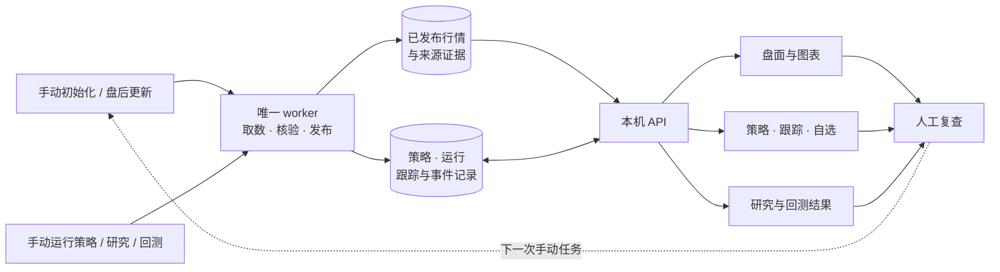

<div align="center">

<h1>冒险的梦想家</h1>

<p><strong>把盘面、筛选和后续观察连起来的本地 A 股研究工作台。</strong></p>

<p>盘后看全局 · 用条件筛选 · 留下可复查的记录</p>

<p>
<a href="#界面预览">界面预览</a> ·
<a href="#开始使用">五步上手</a> ·
<a href="#主要功能">功能地图</a> ·
<a href="#工程亮点与性能优化">工程亮点</a> ·
<a href="#docker-安装">Docker 安装</a> ·
<a href="#文档导航">文档导航</a> ·
<a href="CHANGELOG.md">版本记录</a>
</p>

</div>

这个项目把日常复盘中分散的看盘、查题材、筛选和跟踪整合到一个工作台：先看市场与方向，再把观察写成规则，最后持续复查候选。行情、策略版本、运行结果、跟踪事件和自选记录保存在自己的实例中，可按日期、价格口径与来源证据回查。

| 看清盘面                                           | 写清条件                                                   | 看见后续                                               |
| -------------------------------------------------- | ---------------------------------------------------------- | ------------------------------------------------------ |
| 在同一观察日查看指数、市场广度、行业题材和涨停梯队 | 个股与板块分别配置日 / 周 / 月规则，组合历史事件与今日条件 | 把候选加入跟踪或自选，复查触发事件、加入基准和后续涨幅 |

> **当前发行：v0.1.12**。功能变更见[版本记录](CHANGELOG.md#v0112)，配套源码见 [v0.1.12 标签](https://github.com/DreamerXX0301/ad-market-review/tree/v0.1.12)，安装文件与镜像证据见[本版 Release](https://github.com/DreamerXX0301/ad-market-review/releases/tag/v0.1.12)。完整源码 SHA、镜像摘要和平台结果以本版 `release-image.json` 为准；`master` 的文档更新不改变既有发行标签或运行版本。已有数据升级先阅读[版本升级与回滚](docs/版本升级与回滚.md)。

## 近期新增与改进

| 能力 | 现在可以做什么 |
| --- | --- |
| **龙虎榜与买卖席位** | 分开查看全部榜、机构榜和游资标签，区分单日与三日累计；点击整行展开并定位买卖前五席位，点击名称打开共用 K 线，代码单独复制。支持搜索清除、标签取消与完整结果排序；数据按30个市场交易日滚动留存。 |
| **可组合的技术选股** | BOLL 收口与突破可配合放量、MACD、KDJ，参数自行调整；直接比较上一日 / 完整周 / 完整月的成交量。普通条件支持逐条件周期与嵌套组合，历史事件可绑定同一次事件的参照价；个股策略支持复制为新策略。 |
| **明确的复权与证据** | 个股策略保存原价或本地前复权口径，技术指标和事件参照价使用同一锚点；旧规则、历史运行与入池基准保持冻结。涨停事实、原始涨幅与量能分别核验。 |
| **市场情绪与反馈** | 市场广度温度、阶段、指数环境和下一交易日条件计划集中呈现；区分趋势观察与短线接力。连板反馈概览包含已核验的昨日首板，完整明细保留昨日二板及以上。 |
| **统一的看图与找股体验** | 个股、指数和板块共用单页日 / 周 / 月 K，初次进入或切换周期定位图表；支持滚轮 / 触控板缩放、高低涨幅、距图表截止日的交易日数、板型与事件标记。支撑、压力、事件标签移到右侧，支持单条与全部显隐。 |
| **题材与候选管理** | 题材联合查股支持主板、创业板、科创板、北交所多选；策略、跟踪、自选支持近期热点筛选。概念关联顶部直接展示前20项涨停数量，卡片同排等高、定位避开固定栏。 |
| **更清楚的更新流程** | 盘后整链更新期间锁定业务操作，显示阶段、已用时和有依据的预计剩余，完成后确认解锁；同日同范围已完整成功的操作禁止重复创建，失败或部分完成仍可补齐。 |

近30日涨幅榜保留前100名，并支持全市场搜索；未排名的股票显示基准缺失等原因。当日重点主线由系统按来源线索自动归组，无需逐日补录。独立“资金与轮动”入口已归并至行业与题材，不稳定的行业资金趋势停止展示与新任务采集，旧证据保留。具体交互见[盘面使用与数据核验](docs/盘面使用与数据核验.md)。

## 界面预览

### 01 · 先看全局，再深入一个对象

指数、成交额、市场广度和来源范围放在同一页。沿着行业、概念或涨停梯队进入个股，也可以直接搜索股票、指数、行业与概念；盘面日期可回看已有留存数据。

成交额 TOP 10 标记近7个交易日的持续活跃个股；行业与题材分别展示涨幅榜、成交额榜的近7日上榜次数。展开可核对日期、名次和已核验范围。


### 02 · 把观察写成规则，留下每次运行

历史倍量、收盘涨停等事件与今日条件分别设置。普通条件可以按日、完整周或完整月组合，历史事件仍按交易日定位。个股与板块策略独立运行；批量筛选后，命中进入各自跟踪池，页面保留运行日期、策略版本和实际进度。

<table>
  <tr>
    <td width="50%"><a href="docs/images/strategy-editor.jpg"></a></td>
    <td width="50%"><a href="docs/images/strategies.jpg"></a></td>
  </tr>
  <tr>
    <td><strong>先定义条件</strong><br />写下要观察的事件、时间范围与当前条件。</td>
    <td><strong>再查看结果</strong><br />对照每次筛选的命中、入池、跳过与任务状态。</td>
  </tr>
</table>

### 03 · 从一张图，接上持续观察

一张连续页面查看日 / 周 / 月 K、成交量、BOLL、KDJ、MACD及已确认板型；打开或切换周期后定位至图表，向上仍能查看原有资料。高/低价同时展示相对前收涨幅，紧凑头部保留复制代码、涨幅统计与前后只导航。个股可保存参考、支撑与压力线；显式启用规则后，按已发布日线核验触及、突破或失守，并保留触发依据。

<table>
  <tr>
    <td width="50%"><a href="docs/images/stock-chart.jpg"></a></td>
    <td width="50%"><a href="docs/images/watchlist.jpg"></a></td>
  </tr>
  <tr>
    <td><strong>看图与标记</strong><br />保存观察价位，区分价格口径和触发规则。</td>
    <td><strong>收藏与复查</strong><br />查看首次加入后的变化，并保留原跟踪来源。</td>
  </tr>
</table>

### 04 · 解释结果之前，先看数据覆盖

数据中心把留存数量、覆盖分母和核验说明分开。日 K 与分析行情共用逐股报价缺口诊断，可查看连续日期区间、原始包对照和前后报价，再手动向来源核验。


<details>
<summary><strong>也支持浅色主题</strong></summary>


</details>

截图来自独立展示环境，使用截至 **2026-10-21** 的已留存行情与示例操作；图片只展示界面，未附带私人业务数据库、凭据或行情原始包。截图是拍摄时的界面，后续小幅样式变化以当前源码为准。[完整界面导览 →](docs/界面导览.md)

## 开始使用

完成安装后，按这五步建立自己的研究流程。

| 步骤                  | 在哪里操作                                                      | 会留下什么                                |
| --------------------- | --------------------------------------------------------------- | ----------------------------------------- |
| **1. 接入数据**       | 在「数据源」填写自己的 Key，逐项验证行情、板块和成员等实际能力  | 当前来源可用范围与验证结果                |
| **2. 建立本地窗口**   | 在「数据中心」手动初始化，默认目标近五年，再查看各模块覆盖      | 已发布行情、分类成员、板块 K 线与缺口说明 |
| **3. 选择研究对象**   | 在盘面、行业题材、涨停梯队或全局搜索中打开股票与板块            | 对应观察日的图表、行情摘要与来源说明      |
| **4. 执行自己的规则** | 选择个股或板块策略，配置条件，执行所选或全部策略并跟踪          | 策略版本、筛选结果与各自独立的跟踪轮次    |
| **5. 更新并复查反馈** | 北京时间18:00后手动盘后增量，再查看跟踪、自选与已启用的划线规则 | 后续变化、触发事件和可复查的价格依据      |

板块首次全库 K 线完成后，日常更新只追加尾部。暂停或取消的任务由用户决定是否继续。盘面观察日期与策略、跟踪、研究、回测的日期分别管理，切换盘面日期不会改写业务记录。

## 主要功能

| 你想做什么             | 工作台入口            | 主要能力                                                                                                  |
| ---------------------- | --------------------- | --------------------------------------------------------------------------------------------------------- |
| 从市场找到研究方向     | **盘面研究**          | 沪深广度温度与阶段、下一交易日条件计划、指数 / 广度 / 昨板价格反馈三轴对照；统一连板高度、板型与量能，自动只读主线及手动留存复盘 |
| 查看公开榜单资金证据   | **龙虎榜**            | 单日 / 三日、机构与游资标签分开，买卖前五席位、来源原因、排序与代码复制；与盘面共用观察日 |
| 对照价格与事件         | **图表与全局搜索**    | 单页日 / 周 / 月 K与成交量、BOLL、KDJ、MACD；按绘图区宽度自适应初始窗口，保留完整已加载历史与手动缩放；高低涨幅、紧凑头部、已核验板型与事件标记 |
| 整理自己的分类         | **题材库**            | 行业 / 题材交并集查股、上市板块筛选、成员排序、人工纳入与排除，保留归属修订记录                                         |
| 把思路变成筛选条件     | **策略管理**          | 个股与板块独立策略，嵌套全部 / 任一条件、逐条件周期、BOLL与量能、历史事件、批量执行与个股策略复制                                   |
| 看候选后续怎样变化     | **策略跟踪**          | 默认30个市场交易日，独立提醒与结束规则，热点归属筛选、当日 / 跟踪涨幅、触发事件和历史轮次                       |
| 留下主动观察的标的     | **我的自选**          | 从详情、跟踪或成员列表收藏；热点归属筛选，保留首次加入日、独立基准、原跟踪来源与划线记录                            |
| 围绕单个标的查资料     | **个股研究**          | 六区证据报告：主营构成、财务估值、公告线索、日周月强弱与相对指数、已确认技术位；机构与社区原文入口                                      |
| 在受支持样本内检验条件 | **策略回测**          | 个股独立区间、统计、权益 / 回撤，以及交易、订单、成交与持仓记录；运行前检查条件与数据是否可用             |
| 复查异动与监控名单     | **异动与监管**        | 最新已留存名单与指定日历史分开，名单观察日和行情日独立；供应商标签与官方监管原文区分 |
| 确认数据能解释到哪里   | **数据中心 / 数据源** | 手动同步与任务历史、整链进度、本地覆盖核验、证券名录与上市身份、逐股报价缺口诊断和显式来源核验                                |

自选与策略跟踪各有自己的基准；重复收藏不重置首次加入价。展开板块成分股只供浏览，不会自动创建个股跟踪或套用板块事件价。

市场情绪用页内目录定位指数环境、计划、短线接力和来源；完整统计与个股观察名单默认展开。操作状态采用禁止红色、有条件绿色、等待黄色、未知灰色，股票涨跌及晋级反馈沿用涨红跌绿。下一交易日计划由已留存盘后证据生成，未来条件仍须验证；不将一次放量直接认定为底部。连板反馈按已核验昨日高度降序，缺证据保留未知。详见[市场温度与下一交易日计划](docs/市场温度与下一交易日计划.md)及[连板高度、板型与反馈](docs/连板高度板型与反馈.md)。

## 工程亮点与性能优化

性能处理覆盖计算、存储和页面读取，重点减少同一份数据的重复准备，同时保留收益、指标、候选依据和未知状态的对账。

| 场景 | 已实现的处理 | 生效边界 |
| --- | --- | --- |
| **换策略、微调参数再运行** | 分层复用经来源核验的日 / 完整周 / 完整月技术输入、历史事件尾部和同参数 BOLL 计算；BOLL 参数变化时从严格输入重算对应参数组，修改规则后重新求值并保存新运行。 | 缓存有容量、来源与算法版本约束；更长历史窗口、新字段或证据变化可能重新准备，不复用旧命中名单。 |
| **首次选股计算** | 唯一 worker 可按需启动最多4个纯计算子进程，按有界批次准备输入；父进程保持原顺序求值与落库。 | 子进程不联网、不打开业务或分析数据库、不写缓存；支持 `SHIXU_SELECTION_CPU_WORKERS=0..4`，小任务及不满足条件的输入走原路径。 |
| **保存结果、跟踪与自选浏览** | SQL 只物化所选结果分类，跟踪列表使用必要字段摘要，完整详情按需加载；高频读取批量投影，离开的页面停止轮询。 | 政策、事件和题材归属仍重新核验；同范围刷新保留已有行，切换范围重新读取。 |
| **个股 / 板块图表与盘面** | 复用固定行情代际的有界报价和来源摘要，浏览器按需计算已启用的 BOLL 与波浪叠加；近30日榜按所需窗口批读，避免逐股展开五年历史。 | 首次加载和完整证据核验仍有成本；历史缺口与预热不足不以缓存补造。 |
| **板块尾部增量** | 仅请求已验收尾部之后的缺少交易日，任务内复用来源连接与规划，并预热可丢弃的本地指标摘要；新任务在本次板块尾部批次内采用0.6秒串行请求发起间隔。 | 来源请求仍串行、受权限和限流约束；旧冻结任务保持原政策，网络耗时不等于本地计算耗时。 |
| **存储与升级** | 主行情使用不可变 Parquet 共享对象与增量链，盘面补充引用可复用对象；独立恢复后切换版本，保留最近两套完整回滚集。 | 活动窗口、物理文件与业务引用分别管理；有引用的证据不能按目录年龄删除。 |

验证区分首次准备、重复运行、换规则、参数调整和重启，并比较完整结果、来源 SHA、排序与缺失原因。部分首访仍需秒级或更长时间，不能把局部暖缓存收益宣传成全链路耗时。详细实现与实测条件见[日期切换、选股与浏览性能](docs/日期切换与选股性能.md)和[存储与盘后增量优化](docs/存储与盘后增量优化.md)。

## 数据如何流转

你决定何时取数和运行研究。唯一 worker 处理任务、核验并发布本地数据，页面读取已经发布的结果。



行情快照与业务记录分开保存，策略编辑与收藏等操作通过 API 保存业务记录。已完成运行保留当时的策略版本和输入依据，后续数据更正不会悄悄改写旧结果。来源验权与手动取数会连接对应供应商，本地存储并不代表所有操作都离线。

## Docker 安装

需要 Docker Engine / Docker Desktop 和 Compose。以下流程使用 `ghcr.io/dreamerxx0301/ad-market-review:v0.1.12`，只下载配套部署文件并拉取镜像，无需在本机构建；执行前核对上方发行记录中的镜像可用性、实际摘要及配套源码标签。已有安装请先看[升级与回滚](docs/版本升级与回滚.md)。

源码仓库及已公开的Release附件可匿名下载，镜像也允许匿名拉取；不要求GitHub登录。以下使用 `curl` 获取配套[0.1.12 Release附件](https://github.com/DreamerXX0301/ad-market-review/releases/tag/v0.1.12)，须先确认本版已正式发布。已持有配套源码时，也可复制其中的 `deploy/docker-compose.yml`。下载前检查同名文件，已有文件时先核对版本或使用新目录；已安装并配置GitHub CLI时，也可选用 `gh release download v0.1.12 --repo DreamerXX0301/ad-market-review --pattern docker-compose.yml` 作为便利下载方式。

```bash
mkdir ad-market-review
cd ad-market-review

test ! -e docker-compose.yml && test ! -L docker-compose.yml && \
  curl --fail --location --output docker-compose.yml \
  'https://github.com/DreamerXX0301/ad-market-review/releases/download/v0.1.12/docker-compose.yml'
docker pull ghcr.io/dreamerxx0301/ad-market-review:v0.1.12

umask 077
key_dir="$HOME/.local/share/ad-market-review-secrets"
mkdir -p -m 700 "$key_dir"
docker run --rm --user 0:0 --network none \
  --mount "type=bind,src=$key_dir,dst=/secrets" \
  --entrypoint python ghcr.io/dreamerxx0301/ad-market-review:v0.1.12 \
  /app/deploy/create_secret.py /secrets/master.key
export SHIXU_MASTER_KEY_FILE="$key_dir/master.key"
export SHIXU_IMAGE_REF=ghcr.io/dreamerxx0301/ad-market-review:v0.1.12
export SHIXU_HTTP_PORT=8788

docker compose -p ad-market-review -f docker-compose.yml pull
docker compose -p ad-market-review -f docker-compose.yml up -d api
```

打开 [http://127.0.0.1:8788](http://127.0.0.1:8788)，确认页面正常后启动唯一 worker：

```bash
docker compose -p ad-market-review -f docker-compose.yml --profile worker up -d worker
```

服务只绑定本机。若8788已有实例，请使用新的安装目录、项目名及空闲端口，不共享现用数据卷。主密钥单独保存，恢复旧凭据必须使用原主密钥。需要固定镜像摘要时可通过 `SHIXU_IMAGE_REF` 覆盖默认镜像；更新实例按 `compose.release.yaml` 的摘要流程进行。完整安装和配置见[Docker部署](docs/Docker部署.md)，备份与进程管理见[部署与运维](docs/部署与运维.md)。

## 源码运行与开发

需要当前源码功能时，在本地检出项目后运行。环境要求：Node.js 22.12+、npm、uv、Python 3.13–3.14；Python 的 SQLite 运行库须通过程序版本检查。

```bash
./scripts/dev.sh
```

脚本安装锁定依赖、检查并执行数据库迁移、构建前端，再启动 API 与单个 worker。它适合首次安装和开发；已有业务数据请按[升级与回滚](docs/版本升级与回滚.md)在独立恢复副本验证。

| 源码位置                                                                 | 对应内容                         |
| ------------------------------------------------------------------------ | -------------------------------- |
| `frontend/src/features/market`                                           | 盘面、图表入口与成员浏览         |
| `frontend/src/features/strategies` / `sector` / `tracking` / `watchlist` | 个股与板块规则、跟踪及自选       |
| `frontend/src/features/data` / `sources`                                 | 数据覆盖、任务与来源配置         |
| `backend/app/services`                                                   | 数据、策略、跟踪与研究等业务流程 |
| `backend/app/analytics` / `infrastructure`                               | 指标与回测计算、存储和发布       |
| `contracts` / `backend/tests`                                            | 接口契约、数据结构与检查         |

前端使用 React / TypeScript，后端使用 FastAPI；业务记录保存在 SQLite，行情与分析使用 DuckDB / Parquet。开发约定和检查入口见[贡献指南](CONTRIBUTING.md)、[前端说明](frontend/README.md)与[架构文档](docs/架构与模块边界.md)。

## 数据留存与使用边界

初始化、盘后增量和个股研究由用户手动发起；页面浏览读取本地已发布数据，不因打开页面自动补采行情。来源能力验证和手动采集仍需联网，暂停、取消的任务不会自行继续。

| 数据 | 窗口与清理方式 |
| --- | --- |
| **个股、指数与板块 K 线** | 默认目标近五年活动窗口；真实来源边界、策略引用和指标递推种子独立保留。五年活动范围不代表所有旧物理文件已被删除，代际回收走明确的离线维护流程。 |
| **盘面补充** | 新手动任务成功发布后按250个市场交易日滚动管理；当年统计、业务引用和恢复证据受保护，清理确定无引用的窗口外对象。 |
| **龙虎榜与买卖席位** | 新手动初始化、增量或补齐任务采集，成功验收后按30个市场交易日滚动管理；失败不提前推进清理，必要来源与引用证据保留。 |
| **划线与关联提醒** | 未触发线持续监控；首次实际提醒后继续60个市场交易日，再由新盘后增量清理到期线与关联提醒，重复提醒不延长。自选和策略跟踪保留。 |
| **运行与回滚资料** | 已保存策略、运行、跟踪和手工资料不按行情窗口直接删除；升级验收及独立恢复通过后，仅保留最近两套完整回滚集，再清理已核验冗余副本。 |

旧任务保持创建时冻结的范围与政策。滚动保留不等于总磁盘容量恒定，受保护证据、原始来源和恢复材料仍会占空间。规则见[补充数据250交易日保留](docs/补充数据250交易日保留.md)、[龙虎榜30日留存](docs/龙虎榜设计方案.md)和[划线提醒到期清理](docs/划线提醒到期清理.md)。

理解结果时，主要看这三件事：

- **范围**：近五年是初始化目标，各模块、字段和来源有各自的实际覆盖；当前成员名单不代表历史归属。
- **未知**：缺报价、来源未授权、预热不足或总量未声明时保留未知。精确100%只表示本行声明范围已覆盖，不能解释成全部来源历史齐全。
- **含义**：自选和跟踪涨幅是观察统计，回测也受历史身份、可成交性和字段覆盖限制，不代表实际账户收益；转折结构是候选价格结构。

龙虎榜来源汇总数、实际标签行和已观察股票数量分别统计，累计区间独立；买卖与净额冲突、未披露对手金额保留未知，不凑平、不填零，供应商游资标签不等于已核实账户身份。30日响应留存也不代表每个字段都完整。

目前提供个股回测；完整历史成员、真实筹码价格档、连续封单稳定度等能力尚未完整接入。提醒是基于已发布日线的观察事件，未接入盘中实时告警或实盘自动下单。截图和研究结果不构成投资建议。详细价格、复权、日期和历史样本口径见[实现范围与数据边界](docs/实现范围与数据边界.md)。

## 文档导航

| 现在要做的事             | 从这里继续                                                                               |
| ------------------------ | ---------------------------------------------------------------------------------------- |
| 看更多界面与操作说明     | [界面导览](docs/界面导览.md)                                                             |
| 选择数据源、理解权限     | [数据源与权限](docs/数据源与权限.md)                                                     |
| 安装已发布镜像           | [Docker部署](docs/Docker部署.md)                                                         |
| 配置进程、备份业务数据   | [部署与运维](docs/部署与运维.md)                                                         |
| 查看容量与盘后增量优化   | [存储与盘后增量优化](docs/存储与盘后增量优化.md)                                         |
| 理解选股与高频读取提速 | [日期切换、选股与浏览性能](docs/日期切换与选股性能.md) |
| 查看盘面交互与证券核验 | [盘面使用与数据核验](docs/盘面使用与数据核验.md) |
| 自动支撑压力与热点筛选 | [自动支撑压力线](docs/自动支撑压力线.md) · [近期热点与题材维护](docs/近期热点筛选与个股题材维护.md) |
| 盘后阻塞进度与数据复用 | [进度与确认](docs/盘后增量进度与结果确认.md) · [补充对象复用](docs/补充数据对象复用.md) |
| 配置BOLL与组合条件 | [BOLL选股条件](docs/BOLL选股条件.md) · [BOLL收口研究](docs/research/BOLL收口突破离线研究.md) |
| 理解市场阶段与次日条件 | [市场温度与下一交易日计划](docs/市场温度与下一交易日计划.md) |
| 核对连板高度、板型和反馈 | [连板高度、板型与次日反馈](docs/连板高度板型与反馈.md) |
| 查看龙虎榜与买卖席位 | [龙虎榜使用与30日留存](docs/龙虎榜设计方案.md) |
| 核对滚动保留与提醒到期 | [补充数据250交易日保留](docs/补充数据250交易日保留.md) · [划线提醒到期清理](docs/划线提醒到期清理.md) |
| 更新已有安装或准备回滚   | [版本升级与回滚](docs/版本升级与回滚.md)                                                 |
| 核对指标、价格与历史限制 | [实现范围与数据边界](docs/实现范围与数据边界.md)                                         |
| 理解模块和本地存储       | [架构与模块边界](docs/架构与模块边界.md) · [数据库与数据流](docs/数据库与数据流.md)      |
| 参与开发、报告问题       | [贡献指南](CONTRIBUTING.md) · [安全说明](SECURITY.md) · [交付与验收](docs/交付与验收.md) |
| 查看当前源码和发行差异   | [版本记录](CHANGELOG.md)                                                                 |
