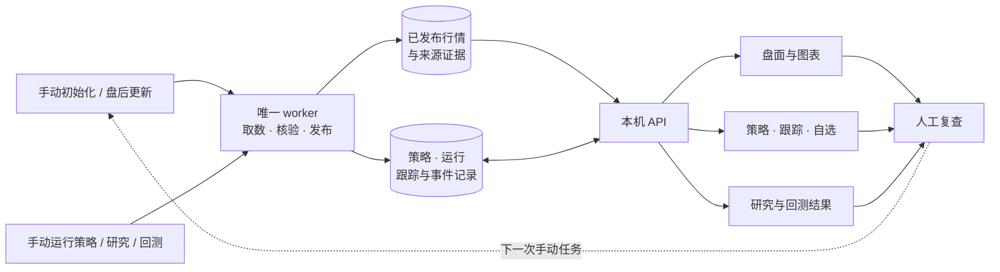

<div align="center">

<h1>冒险的梦想家</h1>

<p><strong>把盘面、筛选和后续观察连起来的本地 A 股研究工作台。</strong></p>

<p>盘后看全局 · 用条件筛选 · 留下可复查的记录</p>

<p>
<a href="#界面预览">界面预览</a> ·
<a href="#开始使用">五步上手</a> ·
<a href="#主要功能">功能地图</a> ·
<a href="#docker-安装">Docker 安装</a> ·
<a href="#文档导航">文档导航</a> ·
<a href="CHANGELOG.md">版本记录</a>
</p>

</div>

从指数和行业题材中找到研究对象，把量能、均线、历史事件和技术条件写成自己的规则，再持续查看候选的后续变化。行情、策略版本、跟踪事件和自选记录保存在本地；每一步都能回到对应日期、价格口径与数据覆盖。

| 看清盘面                                           | 写清条件                                                   | 看见后续                                               |
| -------------------------------------------------- | ---------------------------------------------------------- | ------------------------------------------------------ |
| 在同一观察日查看指数、市场广度、行业题材和涨停梯队 | 个股与板块分别配置日 / 周 / 月规则，组合历史事件与今日条件 | 把候选加入跟踪或自选，复查触发事件、加入基准和后续涨幅 |

> **版本说明**：本页图文介绍[当前源码（Unreleased）](CHANGELOG.md#unreleased)，包含尚未另发镜像的新增功能。下方 Docker 命令安装已发布的 **v0.1.1**；需要本页新增功能时，请从当前源码运行。已有数据升级先阅读[版本升级与回滚](docs/版本升级与回滚.md)。

## 界面预览

### 01 · 先看全局，再深入一个对象

指数、成交额、市场广度和来源范围放在同一页。沿着行业、概念或涨停梯队进入个股，也可以直接搜索股票、指数、行业与概念；盘面日期可回看已有留存数据。


### 02 · 把观察写成规则，留下每次运行

历史倍量、收盘涨停等事件与今日条件分别设置。普通条件可以按日、完整周或完整月组合，历史事件仍按交易日定位。个股与板块策略独立运行；批量筛选后，命中进入各自跟踪池，页面保留运行日期、策略版本和实际进度。

<table>
  <tr>
    <td width="50%"><a href="docs/images/strategy-editor.jpg"></a></td>
    <td width="50%"><a href="docs/images/strategies.jpg"></a></td>
  </tr>
  <tr>
    <td><strong>先定义条件</strong><br />写下要观察的事件、时间范围与当前条件。</td>
    <td><strong>再查看结果</strong><br />对照每次筛选的命中、入池、跳过与任务状态。</td>
  </tr>
</table>

### 03 · 从一张图，接上持续观察

日 / 周 / 月 K 配合均线、MACD、KD 和已确认涨跌停事件查看价格。个股可保存参考、支撑与压力线；显式启用规则后，按已发布日线核验触及、突破或失守，并保留触发依据。

<table>
  <tr>
    <td width="50%"><a href="docs/images/stock-chart.jpg"></a></td>
    <td width="50%"><a href="docs/images/watchlist.jpg"></a></td>
  </tr>
  <tr>
    <td><strong>看图与标记</strong><br />保存观察价位，区分价格口径和触发规则。</td>
    <td><strong>收藏与复查</strong><br />查看首次加入后的变化，并保留原跟踪来源。</td>
  </tr>
</table>

### 04 · 解释结果之前，先看数据覆盖

数据中心把留存数量、覆盖分母和核验说明分开。日 K 与分析行情共用逐股报价缺口诊断，可查看连续日期区间、原始包对照和前后报价，再手动向来源核验。


<details>
<summary><strong>也支持浅色主题</strong></summary>


</details>

截图来自独立展示环境，使用截至 **2026-10-21** 的已留存行情与示例操作；图片只展示界面，未附带私人业务数据库、凭据或行情原始包。截图是拍摄时的界面，后续小幅样式变化以当前源码为准。[完整界面导览 →](docs/界面导览.md)

## 开始使用

完成安装后，按这五步建立自己的研究流程。

| 步骤                  | 在哪里操作                                                      | 会留下什么                                |
| --------------------- | --------------------------------------------------------------- | ----------------------------------------- |
| **1. 接入数据**       | 在「数据源」填写自己的 Key，逐项验证行情、板块和成员等实际能力  | 当前来源可用范围与验证结果                |
| **2. 建立本地窗口**   | 在「数据中心」手动初始化，默认目标近五年，再查看各模块覆盖      | 已发布行情、分类成员、板块 K 线与缺口说明 |
| **3. 选择研究对象**   | 在盘面、行业题材、涨停梯队或全局搜索中打开股票与板块            | 对应观察日的图表、行情摘要与来源说明      |
| **4. 执行自己的规则** | 选择个股或板块策略，配置条件，执行所选或全部策略并跟踪          | 策略版本、筛选结果与各自独立的跟踪轮次    |
| **5. 更新并复查反馈** | 北京时间18:00后手动盘后增量，再查看跟踪、自选与已启用的划线规则 | 后续变化、触发事件和可复查的价格依据      |

板块首次全库 K 线完成后，日常更新只追加尾部。暂停或取消的任务由用户决定是否继续。盘面观察日期与策略、跟踪、研究、回测的日期分别管理，切换盘面日期不会改写业务记录。

## 主要功能

| 你想做什么             | 工作台入口            | 主要能力                                                                                                  |
| ---------------------- | --------------------- | --------------------------------------------------------------------------------------------------------- |
| 从市场找到研究方向     | **盘面研究**          | 总览、指数环境 / 个股广度 / 昨日涨停反馈三轴对照，手动留存复盘；涨停主线归档与更正审计，保留旧版梯队视图 |
| 对照价格与事件         | **图表与全局搜索**    | 日 / 周 / 月 K、指数与个股独立均线偏好、成交量、MACD、KD、高低点价位、所选收盘至观察日涨跌幅与事件标记 |
| 整理自己的分类         | **题材库**            | 行业 / 题材交并集查股、成员排序、人工纳入与排除，保留归属修订记录                                         |
| 把思路变成筛选条件     | **策略管理**          | 个股与板块独立策略，嵌套全部 / 任一条件，逐条件周期、历史事件和批量执行                                   |
| 看候选后续怎样变化     | **策略跟踪**          | 默认30个市场交易日，提醒与结束规则分别设置，查看当日 / 跟踪涨幅、触发事件和历史轮次                       |
| 留下主动观察的标的     | **我的自选**          | 从详情、跟踪或成员列表收藏；保留首次加入日、独立收盘基准、原跟踪来源与划线记录                            |
| 围绕单个标的查资料     | **个股研究**          | 手动查询指定标的行情与近期材料，分项说明查询日期和覆盖，留存研究报告                                      |
| 在受支持样本内检验条件 | **策略回测**          | 个股独立区间、统计、权益 / 回撤，以及交易、订单、成交与持仓记录；运行前检查条件与数据是否可用             |
| 确认数据能解释到哪里   | **数据中心 / 数据源** | 手动同步与任务历史、本地覆盖核验、上市身份、逐股报价缺口诊断和显式来源核验                                |

自选与策略跟踪各有自己的基准；重复收藏不重置首次加入价。展开板块成分股只供浏览，不会自动创建个股跟踪或套用板块事件价。

## 数据如何流转

你决定何时取数和运行研究。唯一 worker 处理任务、核验并发布本地数据，页面读取已经发布的结果。



行情快照与业务记录分开保存，策略编辑与收藏等操作通过 API 保存业务记录。已完成运行保留当时的策略版本和输入依据，后续数据更正不会悄悄改写旧结果。来源验权与手动取数会连接对应供应商，本地存储并不代表所有操作都离线。

## Docker 安装

需要 Docker Engine / Docker Desktop、Compose 和 curl。以下流程安装 `ghcr.io/dreamerxx0301/ad-market-review:v0.1.1`，只下载部署文件并拉取镜像，无需在本机构建。已有安装请先看[升级与回滚](docs/版本升级与回滚.md)。

```bash
mkdir ad-market-review
cd ad-market-review

curl -fL https://raw.githubusercontent.com/DreamerXX0301/ad-market-review/v0.1.1/deploy/docker-compose.yml -o docker-compose.yml
docker pull ghcr.io/dreamerxx0301/ad-market-review:v0.1.1

umask 077
key_dir="$HOME/.local/share/ad-market-review-secrets"
mkdir -p -m 700 "$key_dir"
docker run --rm --user 0:0 --network none \
  --mount "type=bind,src=$key_dir,dst=/secrets" \
  --entrypoint python ghcr.io/dreamerxx0301/ad-market-review:v0.1.1 \
  /app/deploy/create_secret.py /secrets/master.key
export SHIXU_MASTER_KEY_FILE="$key_dir/master.key"
export SHIXU_IMAGE_REF=ghcr.io/dreamerxx0301/ad-market-review:v0.1.1
export SHIXU_HTTP_PORT=8788

docker compose -p ad-market-review -f docker-compose.yml pull
docker compose -p ad-market-review -f docker-compose.yml up -d api
```

打开 [http://127.0.0.1:8788](http://127.0.0.1:8788)，确认页面正常后启动唯一 worker：

```bash
docker compose -p ad-market-review -f docker-compose.yml --profile worker up -d worker
```

服务只绑定本机。若8788已有实例，请使用新的安装目录、项目名及空闲端口，不共享现用数据卷。主密钥单独保存，恢复旧凭据必须使用原主密钥。需要固定镜像摘要时可通过 `SHIXU_IMAGE_REF` 覆盖默认镜像；更新实例按 `compose.release.yaml` 的摘要流程进行。完整安装和配置见[Docker部署](docs/Docker部署.md)，备份与进程管理见[部署与运维](docs/部署与运维.md)。

## 源码运行与开发

需要当前源码功能时，在本地检出项目后运行。环境要求：Node.js 22.12+、npm、uv、Python 3.13–3.14；Python 的 SQLite 运行库须通过程序版本检查。

```bash
./scripts/dev.sh
```

脚本安装锁定依赖、检查并执行数据库迁移、构建前端，再启动 API 与单个 worker。它适合首次安装和开发；已有业务数据请按[升级与回滚](docs/版本升级与回滚.md)在独立恢复副本验证。

| 源码位置                                                                 | 对应内容                         |
| ------------------------------------------------------------------------ | -------------------------------- |
| `frontend/src/features/market`                                           | 盘面、图表入口与成员浏览         |
| `frontend/src/features/strategies` / `sector` / `tracking` / `watchlist` | 个股与板块规则、跟踪及自选       |
| `frontend/src/features/data` / `sources`                                 | 数据覆盖、任务与来源配置         |
| `backend/app/services`                                                   | 数据、策略、跟踪与研究等业务流程 |
| `backend/app/analytics` / `infrastructure`                               | 指标与回测计算、存储和发布       |
| `contracts` / `backend/tests`                                            | 接口契约、数据结构与检查         |

前端使用 React / TypeScript，后端使用 FastAPI；业务记录保存在 SQLite，行情与分析使用 DuckDB / Parquet。开发约定和检查入口见[贡献指南](CONTRIBUTING.md)、[前端说明](frontend/README.md)与[架构文档](docs/架构与模块边界.md)。

## 数据说明

工作台面向盘后研究与持续观察。初始化、盘后增量和个股研究由用户手动发起；划线提醒按已发布日线核验，提供的是观察事件，不是盘中实时告警或实盘自动下单。

理解结果时，主要看这三件事：

- **范围**：近五年是初始化目标，各模块、字段和来源有各自的实际覆盖；当前成员名单不代表历史归属。
- **未知**：缺报价、来源未授权、预热不足或总量未声明时保留未知。精确100%只表示本行声明范围已覆盖，不能解释成全部来源历史齐全。
- **含义**：自选和跟踪涨幅是观察统计，回测也受历史身份、可成交性和字段覆盖限制，不代表实际账户收益；转折结构是候选价格结构。

目前提供个股回测；完整历史成员、真实筹码价格档、连续封单稳定度等能力尚未完整接入。截图和研究结果不构成投资建议。详细价格、复权、日期和历史样本口径见[实现范围与数据边界](docs/实现范围与数据边界.md)。

## 文档导航

| 现在要做的事             | 从这里继续                                                                               |
| ------------------------ | ---------------------------------------------------------------------------------------- |
| 看更多界面与操作说明     | [界面导览](docs/界面导览.md)                                                             |
| 选择数据源、理解权限     | [数据源与权限](docs/数据源与权限.md)                                                     |
| 安装已发布镜像           | [Docker部署](docs/Docker部署.md)                                                         |
| 配置进程、备份业务数据   | [部署与运维](docs/部署与运维.md)                                                         |
| 查看容量与盘后增量优化   | [存储与盘后增量优化](docs/存储与盘后增量优化.md)                                         |
| 更新已有安装或准备回滚   | [版本升级与回滚](docs/版本升级与回滚.md)                                                 |
| 核对指标、价格与历史限制 | [实现范围与数据边界](docs/实现范围与数据边界.md)                                         |
| 理解模块和本地存储       | [架构与模块边界](docs/架构与模块边界.md) · [数据库与数据流](docs/数据库与数据流.md)      |
| 参与开发、报告问题       | [贡献指南](CONTRIBUTING.md) · [安全说明](SECURITY.md) · [交付与验收](docs/交付与验收.md) |
| 查看当前源码和发行差异   | [版本记录](CHANGELOG.md)                                                                 |
