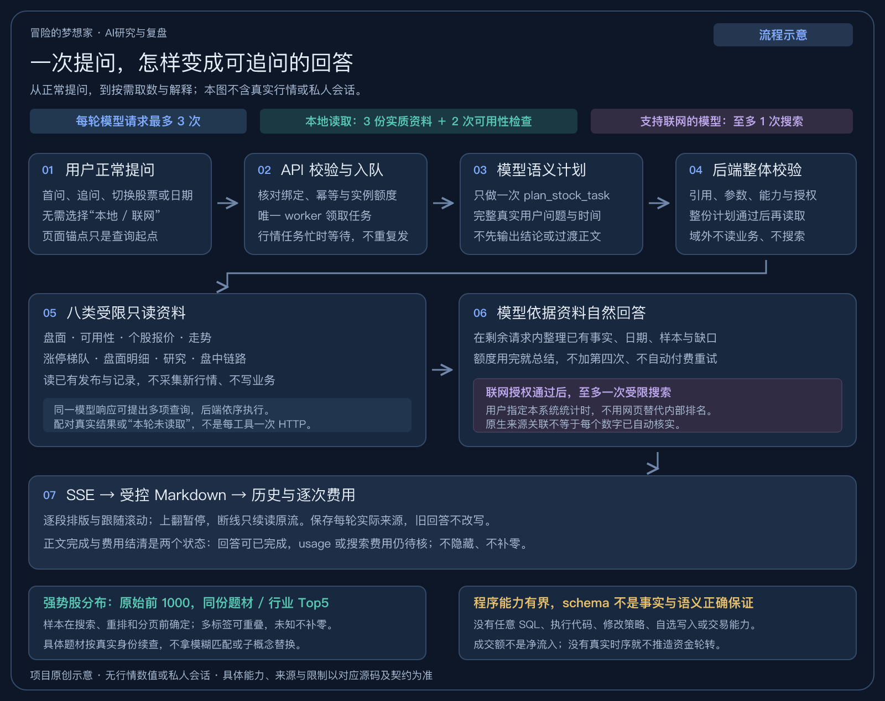

# AI对话怎样取数、回答和继续追问

当前0.1.22源码采用 `ai-agent-round-v5`与schema39。它由模型、后端只读工具、费用账本和前端渲染共同完成，不是把整个数据库交给模型，也不是只靠一段提示词约束所有行为。当前指南描述源码能力；实际部署版本和来源覆盖以各实例为准。

图为项目原创流程示意，不是行情、用户会话或模型思考过程的截图。

## 一次提问怎样走完

以“30日涨幅榜中哪些题材占比高？所选交易日情绪怎么样？收盘涨停有多少家？”为例，下面是一种合法执行路径，不是每次都固定照抄的脚本。

| 顺序 | 谁处理 | 实际做什么 |
| --- | --- | --- |
| 1 | 浏览器与API | 浏览器提交问题、会话/模型绑定、可选观察日和幂等标识。API核对配置、同意发送、问题长度、会话忙闲及额度，保存用户消息和待执行AI任务。 |
| 2 | 唯一worker | 领取任务、读取后端密文凭据，记录实际执行北京时间；必要时只读证券名录核实名称/代码。行情任务占用控制时可能排队，排队不是已经再次调用模型。 |
| 3 | 第一次模型请求 | 发送股票研究角色、当前真实问题、有限的最近用户问题、已核验身份和时间/合法观察日；这一步不发送本地行情报告或先前助手正文。每次HTTP发送前先检查/预留费用并登记回执。模型只提交一次 `plan_stock_task`，选择研究目的和所需工具，不先向用户输出“我查一下”或研究结论。 |
| 4 | 后端控制线程 | 收到完整响应后先按usage更新已登记回执，再核验完整计划的原文引用、冻结能力、工具名、字段、日期格式、枚举、长度及额度；计划整体通过并保存后，才顺序执行资料读取。 |
| 5 | 本地只读函数 | 可选择 `read_market_detail(section=gainers)`、`read_market_detail(section=emotion)`、`read_limit_up_data`。分别返回同份原榜分布、情绪指标和涨停梯队，以及来源、日期、覆盖及截取范围；这三次本地调用不是三次额外模型HTTP请求。 |
| 6 | 第二次模型请求 | 把真实工具JSON/缺口送回模型，恢复有界的正常对话上下文。模型组织中文答案，用Markdown写段落、标题、列表或表格；需要补读或搜索时，只能使用剩余请求和工具额度。 |
| 7 | 服务端与浏览器 | 模型文字逐段经后端事件表及HTTP SSE送到浏览器。前端受控Markdown解析器生成React元素，CSS负责宽度、字号、颜色、表格、气泡与输入框；滚动跟随内容增长，用户上翻时暂停。 |
| 8 | 本地持久化 | 保存最终回答、实际工具结果、来源及逐次费用回执。终态清空执行请求，临时流事件会到期清理；历史消息与费用审计按不同规则保存。 |

“今天”由本次服务器北京时间解析；观察日只是上下文，不能把旧页面日期冒充今天。尚未到时段、已到但未采集、休市、未知及本轮未读取是不同状态，模型应按具体情况说明。

每轮最多3次模型请求；本地最多3次实质读取和2次可用性检查，共5次。第一模型响应可以提出多项本地查询，后端顺序执行并配齐结果。最后一次不再提供新的本地读取或搜索规划函数；已经批准且当前模型支持的原生搜索仍可在最后一次请求执行并直接作答。超额的合法读取返回“本轮未读取”，而不是把整轮变成“股票问题不支持”。

## 本地工具与资料边界

当前共八项受限只读工具，增加工具种类不增加每轮读取或模型请求额度。

| 函数 | 当前能读的资料 |
| --- | --- |
| `read_market_data` | 完成日概览、竞价、午评累计、全天收盘累计及已存资金来源对照 |
| `read_intraday_data` | 所选日七档盘中有界摘要，或指定档的方向、股票样本与相邻封炸跌停变化 |
| `check_data_availability` | 指定日资料状态、时间阶段及已核验日历信息 |
| `read_stock_quote` | 按经核实的证券名称/代码读取指定完成日价量与成交额，不要求先生成研究报告 |
| `read_stock_trend` | 个股日、周、月K线，成交量额、MA/MACD/KDJ、窗口内可核验的收盘涨跌停及同日板块对照 |
| `read_limit_up_data` | 涨停、首板、各连板高度、最高板及相关有界名单 |
| `read_market_detail` | 指数、板块、情绪、近30交易日涨幅榜、竞价/午评、龙虎榜、监管与炸板的已存事实 |
| `read_stock_research` | 已保存且未过期的个股研究及符合边界的同股历史材料 |

这些函数读取已有发布和业务记录，不发起新的行情采集，不延长数据或报告保存期，不接受任意SQL、文件路径或代码。模型没有交易、自选或策略写入工具。API和worker继续遵守各自的SQLite、不可变Parquet及分析数据库边界。

个股走势优先读系统已发布的K线。只报股票名称时，助手先确认研究方向；追问近期走势时用同股默认30根日线，无指定日期取最近已发布完成日。周线和月线默认12根，标出周期是否结束及报价覆盖；K线为未复权，缺档不补线。收盘涨跌停取最近至多30个交易日的原始收盘和已存来源池，板块对照仅使用可核验归属和同源指数日行情。工具不包含实时个股分时、完整长期席位档案或任意多日全板块区间排名。

## 午评和盘后怎样读取当天过程

盘中`read_intraday_data(slot=all)`按0935、1000、1030、1100、1330、1400、1430保留七档状态。指定档可细查方向、股票及相邻池变化。0935是独立开盘观察；原六档/四档任务、缺档日期继续按原冻结版本读取，不以竞价替代，也不跨缺档推断相邻变化。

午评入口调用`read_market_data(section=noon)`。后端先核验本日原午评正文与实际采集结束时点，再从同一所选来源加入竞价、截至这个cutoff已完成留存的全部上午盘中和午评本体。没有下午/收盘正文，也没有午评之后才补存的上午记录；旧午评缺档仍是缺档。

盘后调用`read_market_data(section=close)`。原正式收盘锚点给出观察cutoff和单独的正式发布时间，后端串联同日竞价、全部截至收盘已完成留存的盘中、午评和正式收盘池，原午间至收盘交集回看仍单独保留。缺少正式锚点时全天串联未知，不向当前head或未来日期借数据。所有阶段沿原身份、日期、SHA与AI权限核验，缓存只在一次工具请求内复用，下轮重新核验。

板况变化的行业/题材统计先覆盖完整已核验池差集，再截取Top和样本；不能拿返回几只股票计算占比。行业/题材、上市板块、跌停/回封、方向广度和炸板指标没有原证据时保留未知原因。原时点未存的30日/年内收益或涨停历史明确不可用，不能把后来数据说成当时已有。

## 明细先查哪些范围

`read_market_detail(section=auction/noon)`在原时点全部已留存股票、方向中匹配名称或代码，再有界返回，并保留来源日期、观察数、确认总数和省略量；不要求当天已收盘。分类与成员只能使用原时点引用，缺少归属证据不抹掉独立真实报价。

`dragon_tiger`分开读取所选日的单日、三日股票/机构/游资榜；名称或代码唯一精确命中证券时才附已存席位。匿名席位不合并、单日与三日金额不相加。`abnormal`先在完整已载入监控行内筛选，再截取名单，保留请求日、来源观察日、报价日和期限；来源未完整会标记，供应商监控区间不构成官方监管或解除日期。

先过滤后有界不等于来源覆盖全市场。完整性、已观察命中与确认总数不能混用；未命中只描述本份留存范围，不证明没有对应披露或监管事件。

工具封套最多24KiB，盘中每档汇总3KiB、单档详情10KiB。密集累计优先省略可选样本并计数，再用`phase_fact_columns`共享列名解释`values/rows`和省略数组，来源证明可通过引用复用。原计数、null、日期单位及全部必要阶段保留，不能为塞进预算删除尾盘或正式收盘；不可再压缩时明确容量不足，需缩小时点范围。这些上限约束发送给模型的JSON，不代表底层磁盘读取量。

## 个股深度研究

个股研究从公司经营问题出发。全面研究优先读取同一证券已保存的研究，按实际证据整理主营与收入结构、三张报表、估值市值、披露股东户数、公告与风险。只问单一问题时直接回答。财报报告期、披露日与行情日期分列，经营、投资、筹资现金流保留各自口径。股东户数不能用于识别散户数量或实时持仓。

行业周期需要订单、价格、库存、产能或同业披露支持，题材标签和盘面涨跌不能直接证明行业景气。公告标题只用于定位。缺少原文、授权研报或对比资料时标出缺口，有授权的原生搜索可以补查公开资料。个股报告仍由用户手动生成，AI读取不会创建采集任务；输出会受每轮预算和单次资料容量限制。

## 30日榜的占比和名单怎样保持同一口径

后端先按所选交易日原始近30个市场交易日收益排名取前1000，再统计行业和题材。样本在搜索、前N切换、重排和分页之前固定，不足1000时使用实际样本数。页面摘要与AI的 `ranking_distribution` 复用同一统计对象，模型不拿返回的几只明细重新计算分母。

默认显示题材Top5，可切行业Top5。多标签会重叠，百分比不能相加当作互斥分布；未知、仅交易资格属性分别保留，历史日不使用当前成员倒填。精确排除的来源资格属性见[分布契约](../contracts/gainers-distribution-v1.md)。

明确查询某个已核验分类时，模型使用 `read_market_detail` 的 `gainers_topic` 分区，按真实 `topic_id` 等值筛选。查询“电池相关”这类名称关键词时，使用 `gainers_related`，按已留存分类名称匹配并对股票取并集。两个分区都在原前1000全样本内先筛选，再返回有界名单，分别说明已观察匹配数、可确认总数、返回条数和来源日期。无匹配资料时保留未知。未给日期且没有明确承接日期时读取最新已发布完成日并注明实际日期；明确问今天时保留今天的完成日缺口。旧轮次冻结的分区枚举保持原值。

## 继续追问会发生什么

每次追问都是新的研究任务，重新核对当前问题和允许的用途，再按需取数。会话保存完整历史，不表示每次把全部历史发给模型：当前代码从最近4条已完成消息构造上下文，再受8KiB历史上限裁切。规划阶段仅使用其中真实用户问题；正常回答阶段才恢复有界的用户/助手上下文。较长消息可能让实际保留条数更少，没有无限长期记忆。

因此，“这个题材里还有哪些”“六连板是谁”可以继承最近真实股票主题；明确切换到另一个股票则重新处理该标的。跑题时不应借旧助手回答或默认页面类型授予业务/搜索权限；之后显式回到股票经营问题也不能一直沿用上一轮拒答。

每轮可重新读取同一天资料；这不等于重新联网采集行情。实际工具结果与来源会保存，但工具封套不证明底层每一个文件的物理缓存命中次数。

## 联网也不是把所有资料自动补齐

当前仅为 `gpt-6.1-sol` 接通应用内原生搜索，其他可配置模型不因此自动具备搜索能力。模型可在首个已接受计划或后续规划中提出查询；后端核对研究目的、整条用户引用、来源政策及费用，再给支持的请求至多一次受限搜索。用户指定本系统统计时，网页不能替代内部排行。

搜索得到新闻、公告或片段，不等于得到完整连续K线、真实盘中资金时序或全部候选的经营资料。引用允许域包含交易所及登记财经网站，不能把所有引用都称为已核实的交易所公告。

原生URL、域名、端口、引用位置及数量校验在完整响应返回后进行。**流式文字可能已经显示，最终来源校验才完成**；失败会标未完成。校验链接合规不等于程序已经证明网页内容支持该句结论。

## 输出格式：提示词负责结构，前端代码负责排版

当前模型输出自然语言Markdown。提示词建议先回答、必要时用标题/列表/表格，并非直接生成可执行HTML或一个Word/PDF文档。

前端 `AIAnswerText` 是项目自写的受控Markdown解析器，支持段落、标题、加粗、列表、表格和代码，并做有界渲染；React默认把HTML当文本转义。模型手写的链接/图片不会直接成为可访问的外链或图片，只有后端认可的原生引用生成来源链接。外观和自动滚动分别由CSS、React组件及 `useAIChatFollow` 控制。

当前支持用户图片/文件输入及受控附件预览，但没有让模型生成可执行图表、任意图片或富卡片的输出协议。项目其它页面使用图表组件，不等于AI聊天自动支持图表。要做交互财务图、公司卡片或可导出文件，需要额外的结构化数据/组件或导出接口，不能仅靠提示词说“请画图”便视为实现。

## 图片、文件与提示词的关系

附件接入是程序能力，不是给提示词写一句“支持文件”就能实现：浏览器在内存准备草稿，API校验大小/类型/真实内容，PDF/DOCX本地提取正文，原件一次保存到对应用户消息；任务只存引用，worker核对归属及SHA后临时装配图片。OpenAI Responses接收 `input_image`；DeepSeek接收可读正文，图片被明确阻断。原件不会重复写入任务和助手审计，历史读取只回元数据及受控同源下载地址。

附件正文作为不可信用户资料进入原有语义计划；文件中“忽略角色”等文字不能改变股票领域、工具权限或成本限制。首阶段允许理解附件与问题，不提前把全站行情、报告或旧助手事实发送出去；之后仍按计划通过的只读工具取数。扫描PDF和内嵌图表没有正文能力，需上传截图；模型识图也可能读错数字，关键行情应与系统来源对账。

有界历史窗口内优先携带最近附件，仍受3个、10MiB和正文24KiB的单轮上限；不会另建向量库、检索服务或进行模型微调。图片的base64不是文字token，按工程预留额外估算，真实usage结算。完整限额、存储、清理与恢复见[附件契约](../contracts/ai-workbench-v1.md#用户附件与多模态输入)。

## 哪些是程序硬限制，哪些仍依赖模型

| 事项 | 代码执行的限制 | 仍不能自动保证的部分 |
| --- | --- | --- |
| 股票领域 | 真实用户引文、purpose枚举与资源授权链；域外计划不执行资料工具/搜索 | 是否应判股票、跑题或需澄清仍是模型语义判断，schema不能证明判断正确 |
| 可做的操作 | 冻结工具、严格参数、只读执行；无任意SQL/代码/业务写入能力 | 选择的工具是否足以回答、资料是否完整代表问题对象 |
| 事实输入 | 身份、日期、代际、来源权限与SHA，确定性计算部分统计；缺口/裁切显式返回 | 供应商本身无误、模型始终正确复述数值、日期和范围 |
| 回答与推论 | 提示词要求区分事实、假设和未知 | 当前自然对话没有逐句核验每个数字、因果、排名或预测，不能承诺零幻觉 |
| 联网来源 | 原生URL与引用合规性检查 | 网页内容真实性、是否确实支持那句文字，或已经检查过整篇公告 |
| 格式与展示 | 受控Markdown/React/CSS、来源链接、流式续传与滚动 | 排版正确不代表结论正确；未实现的图表/卡片不会由提示词变出来 |
| 消耗 | 请求前逐次检查/预留预算，最多3模型请求/轮及固定读取/搜索额度 | 缺少完整usage时无法立即给最终供应商费用，分类本身也可能收费 |

旧结构化证据协议曾有数字占位符和引用ID校验；当前v5自然聊天链路没有调用那套逐块数值校验，不能混称已对每句话进行强校验。对模型推断的控制仍需要角色提示、有限真实上下文、完整性标签、实际工具能力和后续质量评估共同改进。

## 历史、流与费用是三类记录

- 历史会话默认30天，可手动保留；当前最多200会话、每会话40消息。浏览不续期；新查询不改写旧答，删除会话会清除对应消息与临时流记录。
- SSE事件为临时传输记录，终态约15分钟后可有界回收。重连只续读原任务，不因此重新生成或再发一次付费模型请求；过期后仍可读取保存的最终回答。
- 任务/费用回执独立保留。每个模型HTTP请求分别计数；一条用户问题可能有多次请求。完成回答与确认费用是两个状态：usage或搜索计费信息不足时保持待核与保守预留，不当成零元或已花完的最终账单。删除对话不清零费用，也不自动重发待核请求。

业务库实时保存消息；完整恢复包是备份时点的静态快照，不会自动纳入快照后追加的对话，也不随活库删除操作重写。

已清理的临时事件不能拿最终序号当作delta片数，也不能从最终回答推断首字时刻或供应商内部思考过程。核对实际会话应读取保留的工具封套和回执，并明确哪些观测已不可恢复。

## 实现入口

- [逐轮契约](../contracts/ai-agent-round-v1.md)、[提示词v5](../contracts/prompts/ai-agent-round-v5.md)、[工作台契约](../contracts/ai-workbench-v1.md)。
- [API与入队](../backend/app/routers/ai.py)、[会话上下文](../backend/app/services/ai_service.py)、[计划核验](../backend/app/services/ai_scope_semantic.py)。
- [执行与账本](../backend/app/services/ai_agent_runtime.py)、[Responses循环](../backend/app/adapters/ai_agent.py)、[本地读取](../backend/app/services/ai_read_tools.py)。
- [附件校验与正文提取](../backend/app/services/ai_attachments.py)、[附件草稿](../frontend/src/features/ai/aiAttachments.ts)。
- [Markdown渲染](../frontend/src/features/ai/AIAnswerText.tsx)、[SSE接收](../frontend/src/features/ai/useAIStream.ts)、[滚动跟随](../frontend/src/features/ai/useAIChatFollow.ts)。
