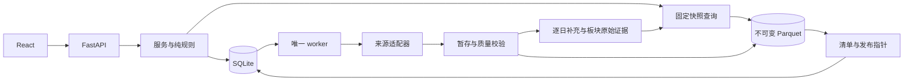

# 架构与模块边界

冒险的梦想家是本地运行的 A 股盘后研究应用。React 通过版本化 HTTP API 调用 FastAPI；SQLite 保存业务事实，DuckDB 在进程内查询不可变 Parquet。当前能力与数据限制见 [README](../README.md)。

## 目录职责

| 目录 | 责任 |
| --- | --- |
| `frontend/src/App.tsx`、`components/AppShell.tsx` | 页面装配、导航、主题、独立日期域 |
| `frontend/src/features` | 盘面、题材、个股与板块策略/跟踪、研究、回测、数据中心和来源界面 |
| `frontend/src/components`、`lib` | 图表、表格、弹窗、检索、HTTP 和格式化；不计算业务信号或保存业务事实 |
| `backend/app/routers` | 参数校验、HTTP 状态及用例入口 |
| `backend/app/domain` | 白名单 AST、三态判断、身份范围和跟踪生命周期；不发送网络请求 |
| `backend/app/services` | 来源、同步、市场、策略、跟踪、研究的编排与事务边界 |
| `backend/app/analytics` | 指标、日周月聚合、固定快照读模型、图表口径和回测账本 |
| `backend/app/adapters` | 来源认证、响应校验、单位、限速及有限重试 |
| `backend/app/infrastructure` | 路径、连接、迁移、密钥、文件清单和发布指针 |
| `backend/app/migrations` | 有序迁移；已应用文件不得改写 |
| `contracts`、`scripts`、`deploy` | 接口约定、显式管理工具及部署配置 |

后端保持一个模块化应用，运行 API 与唯一 worker。API 可写 SQLite 短事务；worker 负责外部行情采集、分析文件写入和发布。API 不打开另一个进程正在写入的原生 DuckDB 文件。

## 数据路径与发布

主行情先写文件、验证清单，再在 SQLite 同一事务中切换相关模块 heads 和业务日。失败保留旧发布；修订创建新代际，不修改旧文件。策略提交与跟踪核对还会检查运行开始时的 SQLite 行情依赖，防止计算中换代后保存混合结果；这不等于 SQLite 同时管理了独立补充文件的 head。

盘面补充独立保存来源原响应、规范化产物、参数签名与 SHA，并在完成后切换自身索引。板块 K 线缓存保留原始全段基底及后续尾部 receipt 链。页面 GET 只读已验本地数据，不隐式调用供应商。

## 初始化与日常更新

新安装默认目标近五年。用户手动提交初始化，冻结授权链：**主行情 → 题材目录/成员 → 全库板块 K 线 → 盘面补充**。各阶段有自己的质量与完成状态，主库已发布不代表附属阶段全部成功。

全库板块首次采集通过冻结任务与 SHA 清单证明全部目录对象可用后，初始化入口在 UI、创建、执行、重试和继续层均锁定。来源首日缺口可以使质量为 partial，但不允许因此反复整库初始化；确有失败或未采对象时可补缺。

新盘后增量由用户在北京时间 18:00 后手动触发：主行情发布后，板块仅请求已验尾部之后缺少的交易日，再补当日盘面。新目录代码首次补完整历史。旧冻结任务没有新链版本时沿用原范围；显式暂停/取消不自动继续。系统默认不开实时轮询或每日新建任务。

## 业务与日期边界

| 模块 | 日期与数据责任 |
| --- | --- |
| 盘面八页 | 共享所选观察日；每页独立披露真实覆盖，不能把主行情区间当作所有来源区间 |
| 题材库 | 当前来源成员叠加人工纳入/排除；撤销人工修改回到来源集合，保留审计 |
| 个股策略 | 冻结规则版本、计算版本和行情依据；股票范围独立 AND，不能被内部 OR 绕过 |
| 板块策略 | 独立表与接口，仅筛行业/概念指数；拒绝 ST、涨停和股票上市板块等个股条件 |
| 个股/板块跟踪 | 独立轮次和事件；提醒不移出，结束归档，不重置入池锚点 |
| 研究 | 指定标的后手动取材料；行情截止、材料日期和获取时间分别记录 |
| 个股回测 | 独立区间、输入版本和账户账本；板块没有回测或自动下单 |

普通策略叶子可选择日、完整周、完整月，默认继承策略周期。周/月只使用观察日之前最近应闭合且有效的周期；缺失该周期不能退到更早周期冒充。日线事件、新高窗口和本轮价格锚点保持市场交易日口径。历史事件先在日线窗口匹配自定义条件，再与本节点绑定的事件价格比较，不使用未来数据。

盘面日期不改变题材、策略、跟踪或回测。股票范围中的当前 ST/板块身份有明确限制，不能当作历史逐日身份。未知报价、指标、身份或来源覆盖保持 null/unknown，不补零、不拿旧报价代替当日。

## 行情、成员与价格口径

板块指定日指数价格与历史成分是两种能力：有真实指数行情时仍显示价格和成交额；缺历史成员时成员数量、涨跌停统计及成员入口保持未知。当前目录只用于身份和命名，不宣称历史目录完整。最新成员采集日与股票报价日分别显示，不用当前成员回填历史。

图表支持 D/W/M；月周柱由本地日线聚合，形成中、首周期不完整和缺报需披露。报价序列连续指标只是显示选项，不补 K 线，也不改变策略/跟踪/回测的严格信号。前复权是已核验公司行动的本地显示变换；候选转折结构不是确定浪型或交易指令。收盘涨跌停标记只来自核验来源事件，不按涨幅阈值猜测。

个股和成员页共用年内收益、精确 30 市场交易日收益、年内涨停次数及最近确认日期。次数下界不冒充完整次数；最近已确认日期不一定证明历史上的绝对最近。指数成交额不当作净流入，跨日资金趋势不称全天盘中时序。

## 缓存、空间与安全

固定行情代际的读模型与指标摘要采用有界缓存。板块派生摘要可持久化，但每次命中仍验证实际原始/规范化来源 SHA；损坏或口径变化后重算。派生缓存是可丢弃加速层，不是行情事实。跟踪只缓存固定日价，政策、题材、期限和事件每次重新读取。

研究缓存按最后主动访问后七天到期，列表轮询不续期。自动清理只处理研究自身材料、报告及引用，保留其他模块的 pin。

增量下载不代表存储只追加尾部：主行情仍可能重写完整原始/规范化代际，题材发布也可能复制行情文件。旧代际、原响应、结果账本和备份持续占空间；当前不默认自动清理全部已发布历史。容量应按实际数据与保留策略估算，不能用单代大小承诺长期空间。

凭据在后端加密，主密钥与密文分开保存；不进入 Git、浏览器持久化、日志或导出。迁移、备份、恢复及升级的操作边界见[数据库与数据流](数据库与数据流.md)和[部署与运维](部署与运维.md)。

接口分工见 [Analytics API](../contracts/analytics-api.md)、[Workspace API](../contracts/workspace-api.md) 与[前端调用约定](../contracts/frontend-needs.md)。
