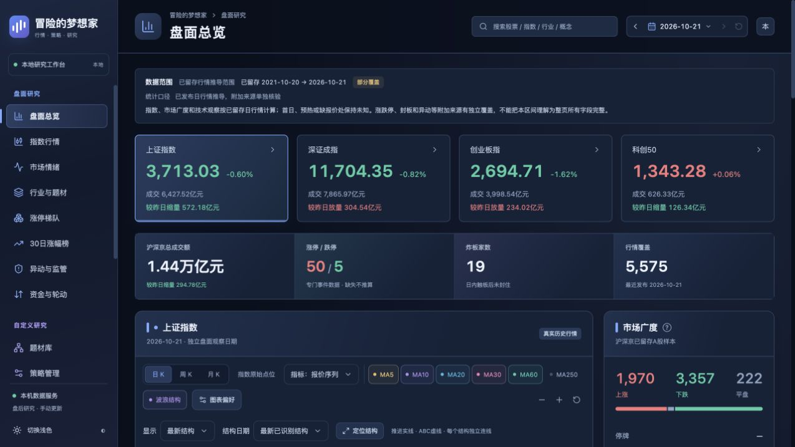
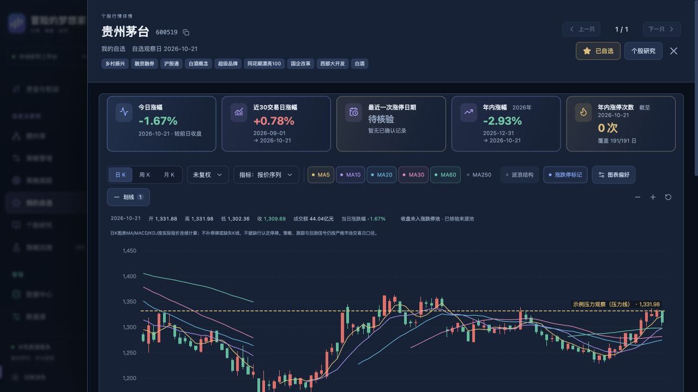
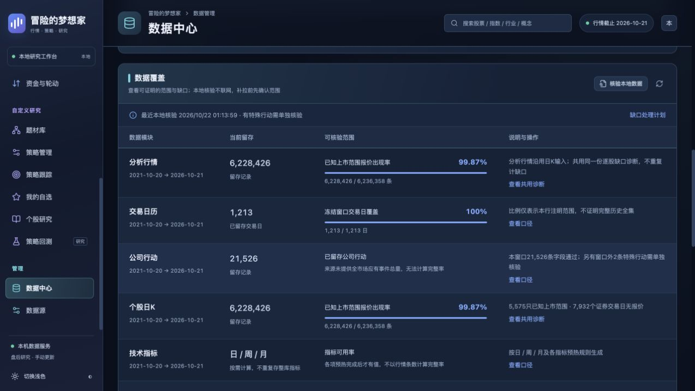
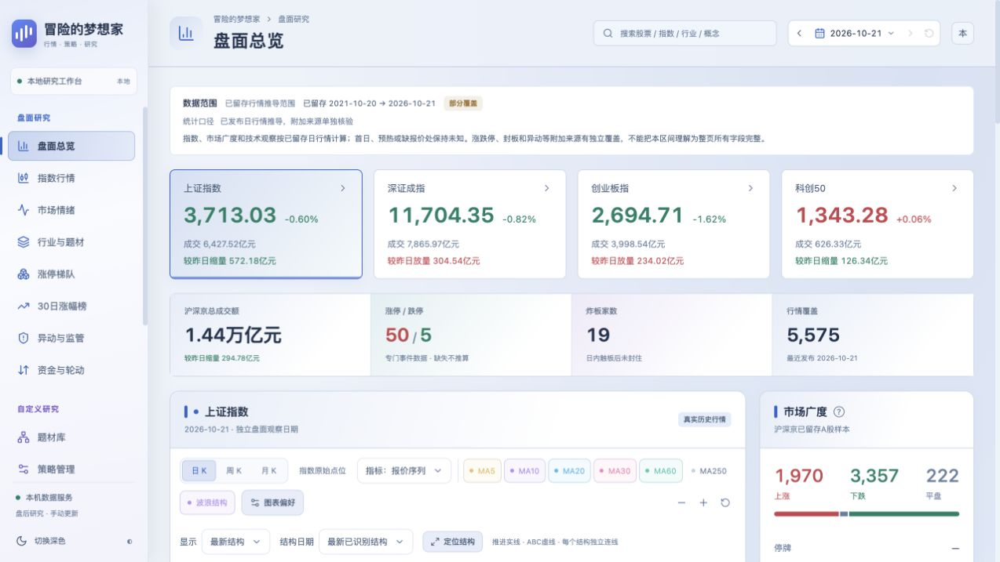

# 界面导览

用一次研究过程认识工作台：先看盘面，写出条件，运行并跟踪，再回到图表和自选复查。

> 本页说明[0.1.13 的已实现功能](../CHANGELOG.md#v0113)，发行源码以 [v0.1.13 标签](https://github.com/DreamerXX0301/ad-market-review/tree/v0.1.13)为准。镜像摘要与平台检查以[本版 Release](https://github.com/DreamerXX0301/ad-market-review/releases/tag/v0.1.13)的`release-image.json`为准。安装入口和五步流程见[项目首页](../README.md#开始使用)。

本版新增行业与概念联动、同日已完成选股直接查看、炸板样本分布与午评收盘回看。截图保留拍摄时样式，不作为新功能视觉验收截图。

截图来自独立展示环境，使用截至 **2026-10-21** 的已留存行情。示例自选、策略草稿和水平线只用于介绍操作，不包含日常使用环境的私人业务记录；图片未附带原始行情包、凭据或数据库。图中股票和价位不构成交易建议。截图保留拍摄时样式，当前源码的后续调整以实际界面为准。

## 按研究任务找入口

| 现在要做什么           | 从哪里进入                                 | 先看哪项信息                                 |
| ---------------------- | ------------------------------------------ | -------------------------------------------- |
| 确认当日市场环境       | 盘面总览、指数行情、市场情绪               | 观察日期、来源范围、指数与市场广度           |
| 找一个具体研究对象     | 行业与概念、涨停梯队、30日涨幅榜或全局搜索 | 板块与成员的各自数据日期、已确认事件         |
| 复核上榜股票的买卖结构 | 龙虎榜                                     | 单日/三日范围、披露原因、买卖席位和来源缺口  |
| 写规则并筛选           | 策略管理 → 个股策略 / 行业概念策略         | 周期、历史事件窗口、今日条件                 |
| 复查后续变化           | 策略跟踪、我的自选、个股图表               | 入池或加入日期、价格基准、提醒与结束规则     |
| 解释缺数与覆盖         | 数据中心 → 核验本地数据 / 查看共用诊断     | 有效分母、未知原因、原始包对照与来源核验结果 |

## 1. 看清盘面和观察日期

盘面总览集中查看指数、成交额、市场广度与情绪，再进入行业题材和个股研究。顶部日期用于回看已留存盘面；当前数据日期与覆盖说明仍保留在页面中。

“分歧最大 · 炸板池前五”和“封单资金前五 · 收盘快照”在名称旁展示所选交易日的今日涨幅，涨红跌绿，缺失显示“—”。点击涨幅表头仅重排已入选前五样本；默认仍分别按开板次数、成交额及封单金额排名，封单金额仍是单次快照。

“成交额 TOP 10 · 个股”增加“近7日活跃”：统计含观察日的最近7个市场交易日，在同口径本地成交额前10榜中的出现次数；重复至少2次标记持续活跃。展开查看具体日期、名次和成交额。下方活跃方向只归纳本日榜内持续活跃股票在观察日可核验的题材关联，不代替主线归因。

“行业与概念”分别标记近7日的涨幅前10、成交额前10次数，行业在同一层级内比较，涨幅榜仅计正涨幅。两个固定口径不随涨跌、资金等当前排序改变；来源指数与成员样本派生数据分开，异源同名板块不合并。上述次数只表示本地留存榜，缺少交易日或证据时显示已观察次数与日期范围，不能将未知当成未上榜，也不把部分样本的出现次数称为完整榜的保守下界。

盘面总览显示紧凑的“连板反馈概览”，可跳转市场情绪看完整内容；市场情绪采用左侧“连板样本反馈”、右侧概览，小屏上下排列。市场读数后紧接指数环境，再展示计划与候选；左侧目录按实际页面顺序排列，来源与留存独立放在最底部。完整统计与个股观察名单默认展开，仍可手动收起；市场情绪的当日/前日成交额统一以亿元展示，同时给出可核验的增减金额与百分比；题材核心候选和独立个股名单均可复制股票代码。独立“资金与轮动”和行业资金趋势已撤下；旧地址转到行业与概念，不混用旧日资金冒充当日数据。概览包含经前日涨停池及收盘证据核验的首板；明细及其上一只、下一只仅保留昨日二板及以上样本，首板不加入明细。概览不受明细分页和排序影响，平均和中位涨幅只计已知值，未知单列，按昨日高度由高到低比较。首板来源缺失显示待核验，不填零；统计仅代表返回样本。题材默认显示前三项，其余点击展开；行业及归属按观察日证据展示。

本地与服务器分别保存自己的历史来源证据，更新程序不会同步两边数据库。旧版行业资金资料继续留存核验；当前界面已撤下不稳定的行业资金趋势，新任务停止采集该来源，不沿用旧日资金冒充当日数据。

“龙虎榜”与盘面共用观察日，默认全部榜、单日披露；机构榜与游资榜独立切换，三日累计不混入单日统计。股票名称打开统一K线详情，上一只/下一只跟随当前筛选的全量去重顺序；点击行内其他位置立即展开并定位到该股席位，代码复制按钮单独操作。买方前五、卖方前五分别显示名称、买入、卖出和净额，同名匿名机构不合并；同日多项披露原因可切换。搜索框支持清除，游资标签再次点击取消；表头先对完整筛选结果排序，再分页，未知值始终置后。

龙虎榜只读本地存档，首次不会在打开页面时自动采集。切至最新行情日后可手动“补齐最近30个交易日”，到数据中心查看任务进度；完整成功后按钮禁用，存在缺口时仍可定向修补。榜单与席位按最近30个市场交易日滚动，历史回看不改变清理锚；缺少记录与真实无上榜分开显示，不影响五年K线、自选、策略与跟踪。详细口径见[龙虎榜使用与30日留存](龙虎榜设计方案.md)。

“异动与监管”只保留一张名单表，默认查看最新已留存供应商监控名单，可切换“指定盘面日历史名单”。范围选择、名单日期、行情日期与记录数集中在表格工具栏；获取时间、来源和覆盖说明默认收起，可展开“来源与日期说明”查看。最新名单日期与盘面选择日不同时会提示，不能用最新名单回填历史。例如周六初始化取得24日名单、行情截至23日，最新名单仍可查看，点击股票打开23日行情；23日历史名单缺档仍显示未知。页面刷新只重读已发布存档，不联网补采。供应商区间不等于交易所官方监管期限；未接入正式解除证据时，官方监管结束日保持未知。

从这里可以进入盘面各页，也能搜索股票、指数、行业与概念。切换盘面日期只影响盘面研究，不会改写策略、跟踪和回测的业务日期。

行业与概念的名称用于打开板块K线，行内其他位置展开成员；宽屏左右两区独立滚动，窄屏上下排列。成员支持板别筛选、排序、代码复制与当日确认涨停标记。近期活跃仍分别统计近7市场交易日上涨前10及成交额前10，持续活跃以星标提示；不新增未经核验的产业链供货事实。炸板分类百分比来自本批关联股票的等权平均涨跌幅，不是行业或概念指数，详见[盘面使用](盘面使用与数据核验.md)及[炸板结构](炸板结构与后续反馈.md)。

午评在午休窗口每天手动采集一次，成功盘后增量后追加同日“收盘回看”；原午间事实不被覆盖，缺午评时不补造。采集、观察、收盘核验与28自然日清理规则见[午评快照](午评快照.md)。

## 2. 把观察写成筛选条件

历史事件与今日条件分开编辑。历史窗口支持前1至 N 个交易日、自定义范围或指定前 N 日，不含今天；可以先选历史倍量、已核验收盘涨停或自定义事件，再组合今天的涨幅与技术交叉条件。下图是尚未保存的示例草稿。

个股与板块策略各自配置。普通条件可使用日、完整周、完整月；日线历史事件仍按市场交易日绑定，未完成周期和缺少证据的条件保留未知。完整语义见[周期、信号与价格](实现范围与数据边界.md#周期信号与价格)。

个股策略详情可点“复制”，以当前全部条件、BOLL等参数、周期、价格口径、热点范围及默认跟踪政策预填新策略。名称默认追加“副本”，可以修改后保存；打开或取消不会创建数据。保存后是独立的新策略，从V1开始，不带原运行结果、跟踪轮次或自动运行配置，也不会自动执行，之后调整副本不会影响原策略。

条件组底部的“快捷添加条件”默认收起，打开后先选条件，再点“加入条件”。仅选择模板或修改参数不会改变规则；加入后可在当前组看到展开的普通条件，最后点“保存策略”才保存生效。取消添加不改草稿，添加也不会自动运行策略。

只比较量增量减时，可直接选择“成交量大于前一周期（放量）”或“成交量小于前一周期（缩量）”并设为“是”，也可从快捷条件加入，无需填写倍数。两者跟随该条件的判断周期：日K比较前一个市场交易日，周/月K比较前一个完整周/月。成交量相等时两者均为否，不放量不能当作缩量；当前或前期缺量、缺报价或零量停牌时保持待核验。原有成交量倍数条件仍可用于至少1.5倍、三倍量等门槛；其数值口径保留，例如当前零量时可能显示0，不能据此判为已确认缩量。“成交量 > 字段 成交量”的两边都取同一周期，不能表示今天大于昨天。

快捷条件包含“MACD水上金叉”“KDJ低位金叉”和“KDJ K>D状态”等。低位上限默认20，可先修改；加入后仍可逐项调整。水上金叉是当期刚上穿且DIF、DEA都大于0；KDJ低位是当期刚上穿且K、D都低于上限。若只希望月线维持K>D，选择状态并使用完整月K即可，不必要求月月金叉。每个入口只向所在条件组添加；历史事件的“历史曾出现”和“今日满足”分别添加，内部固定日K。

添加“历史出现过＋今日满足”后，可在“事件后的价格过程”启用守位或收复。守位填写最大允许回撤，可再要求真实回落、昨日或近N日靠近保护价；收复选择事件收/高/低基准及持续站上、重新收复、首次、最高达到或实际触及。两项默认关闭，不会修改旧策略；“守位后今日回升”和“事件价重新收复”快捷设置用于建立草稿，原有MACD/KD等今日条件继续保留。

例如历史事件选择前2—30日内的三倍量，回撤5%、昨日靠近幅度1%，再加今日涨幅≥2%。事件收盘10元，则全部事后收盘须守住9.50，昨日收盘在9.50至9.595且低于10，今天再达到设定涨幅。重新/首次收复需要事件后有独立的昨日，若窗口包含昨日且最近事件恰好在昨日，系统不会偷偷改选旧事件。结果中的“查看事件依据”展示保护价公式、最低可比收盘与日期、破位、回踩、昨今价、此前收复或待核验日。

“多个事件匹配时”还可选“范围内任意一次满足”：例如近30日出现两次三倍量，最近一次的事件价为12元、另一次为10元，今日收盘11元；若今日条件为收盘高于事件价，任意一次模式可以命中10元那次。其守位、收复和今日条件都须依同一天完整通过，结果及K线只标出最近的完整满足事件。最近/最早模式仍先锁定各自事件，不因后续条件失败改选；一般新建规则仍默认最近一次，上次金叉过程也仍限定最近一次。

若只要求历史出现倍量，请检查并移除不需要的“今日倍量”条件；已有条件会继续参与原条件组判断，历史倍量不会自动替代今日倍量。

在历史事件中可把倍量、收盘涨停、涨幅阈值组成“任一满足”，回看30/60个交易日并取最近一次；今日条件再设置MACD或KD金叉。今日收盘的比较对象选事件价百分比，正3表示事件价上方3%，负3表示下方3%，界面展示公式。要限制今收在事件价上下3%以内，可以用全部满足组合两个带等号的上下界。

百分比偏移只比较今日收盘与事件价；“期间收盘守位”检查事件后每一天，两种条件可以独立使用或同时开启。

从选股结果打开个股K线，可直接看到本次规则实际绑定的历史事件标记、日期竖线与事件价横线；点击“定位事件”把该日纳入可见区间。“最近/最早一次”沿用已保存结果，不在图上重新挑选。横线显示规则涉及的原事件收盘、高、低等参照价，百分比门槛仍以规则依据为准；这些参照与入池、自选基准独立。跟踪、自选和搜索也可按已保存轮次查看；明确改选轮次后标记同步切换。前复权时按本图锚定日换算，缺少或冲突的报价保留原因，不用邻近K线代替事件日。周/月K标在事件所属周期，原事件日期仍按日K显示。

选择MACD或KDJ的上次金叉模板，会明确设置从昨日回看60个交易日、最近一次纯同类金叉，并加入期间死叉、今日再次金叉和今收高于前次事件收盘。回看长度可改；“上次”只在所选窗口内查找。该过程不允许把历史窗口改成排除最近日期、改选最早或在历史金叉中混入K/水上/价格筛选；今日价格与K范围放到“今日条件”。若只希望修改价格门槛，直接编辑今日事件价比较条件即可。

快捷条件中的K值范围支持低/中/高快捷起点和手动上下限，也可直接选“KDJ金叉＋K范围”。它只约束当前K，闭区间包含上下限；快捷填入0–20、20–80、80–100后仍可改数值，不改变KDJ指标计算参数，也不自动修改已经保存的策略。

普通条件中还可直接选择“BOLL收口与方向”，设置当期收口、上/下突破或上/下方回轨，调整周期、标准差倍数、历史分位及前置收口范围；可进一步要求中轨方向或带宽扩张。与放量、MACD、KDJ放在同一全部/任一组即可组合，保存后手动运行。默认只在出现刚收盘越轨的当期命中突破；图表的BOLL显示参数不会改写策略。历史事件的“今日满足”支持日线BOLL，历史事件日扫描暂不支持。完整设置与例子见[BOLL选股条件](BOLL选股条件.md)。

策略表单的“技术指标价格口径”可选未复权或本地前复权。新建默认本地前复权；编辑旧策略会显示原保存口径，切换并保存后产生新版本。运行结果同时标明该次冻结口径和每只股票的实际可用口径；旧结果不随当前选择改变。均胜电子这类已具备本地前复权依据的股票，可以连续使用除权前后的价格指标；缺报价、缺公司行动或不完整周期仍需核验。

个股详情顶部明确标注“原始收盘报价”，下方“图表价格”单独显示图表实际口径。悬停K线时，浮窗和日期旁显示“距行情截止日 YYYY-MM-DD · N个交易日”；悬停前一市场交易日为1，行情截止日为0。历史回看以该图截止日计算，周/月按末根实际报价计距，不按电脑当天或K线根数推算。

扶摇留存的“几天几板”来源文本与连板高度分别展示；相同首板/连板标签去重，缺失或冲突不补猜。它是所选日来源描述，不表示系统已独立重建完整涨停路径。

## 3. 执行、跟踪，保留这次结果

选择多个策略或执行全部，依次完成筛选并将命中加入各自跟踪池。页面显示各策略的实际状态和结果，已有轮次与手动忽略项不会重复入池。

返回页面可恢复已保存结果，重新执行用于刷新；任务栏显示当前任务、真实阶段及已报告进度。策略跟踪默认观察30个市场交易日，提醒与提前结束条件分别设置。板块只跟踪板块自身，展开成分不会创建个股轮次。

## 4. 在图表中留下观察价位

个股详情依次展示今日涨幅、近30交易日涨幅、最近已确认涨停及距离、年内涨幅、年内涨停次数。图表支持日 / 周 / 月 K、MA，以及成交量、BOLL、KDJ、MACD 独立副图，并可保存参考线、支撑线和压力线。

个股与行业、概念板块K线使用一张连续滚动页面。打开后自动定位至图表，成交量、BOLL、KDJ、MACD默认同屏；向上滚动或点击“↑顶部资料”查看原有题材、涨幅和年度统计，点击“定位图表”返回。名称旁集中展示首板、连板、来源几天几板及已核验板型。切换日/周/月K后也定位至图表；用户手动滚动后不会因晚到的数据再次拉回。固定名称栏支持复制六位代码，集中当日/30日涨幅、最近涨停日期与年内次数；前后只沿入口当前已加载列表切换，无列表范围时禁用。板型较多或窄窗口时分行，不将统计挤入K线画布。

日K默认最近120个市场交易日，周K默认近800交易日涉及的完整周柱，月K默认近1500交易日涉及的完整月柱。窗口包含行情截止日；指标仍使用完整留存历史预热。日历证据不足不按报价根数推算，保留范围并提示待核验；留存不足目标窗口时明确提示。图内滚轮及触控板手势缩放，图外滚动页面；拖动、底部范围条和放大/缩小按钮继续可用。

K线高/低价旁和悬停提示同时显示最高/最低涨幅，参照同口径前收，分别标明参照日期。日线须有严格前一交易日报价；周/月使用前一完整周期收盘，形成中、不完整或复权证据不足保持待核验。指数与板块采用各自真实点位前收，指数不显示个股涨停统计。

悬停历史K线时，日期旁及浮动提示会显示“距行情截止日 YYYY-MM-DD · N个交易日”；起点报价日不计、观察日计，同日为0。观察日就是本图的行情截止日，历史回看不会按电脑当天计数；停牌或缺报价仍按已留存市场交易日日历计距。周/月标为“末根报价距行情截止日”，以该柱最后实际报价日为起点，保留形成中和缺报价说明。日历或旧研究报告缺少距离依据时显示待核验，不用自然日、K线根数补算。

从30日涨幅榜、龙虎榜、行业题材成员、搜索、自选或策略打开股票，都使用同一套详情、行情摘要、K线和个股偏好。头部始终显示实际报价日的未复权收盘价及涨幅，标明非实时；悬停历史K线或切换周/月不会改变。不同入口只保留自己的观察日期、当前已加载榜单的上一只/下一只范围，以及确实存在的策略或自选事件；普通查看不会创建跟踪记录。

“行业 / 题材”显示当前本地来源与人工修改后的有效归属，与自选列表一致，标明关系有效日；悬停标签可查看各来源采集日和成员覆盖。历史图同样可以查当前资料，但明确为“当前归属，非历史归因”，不会把当前概念补成历史涨停原因。暂未取得归属与确认不属于是两回事。

截图中的“示例压力观察”是展示环境新建标记。保存价位后，可显式启用以下日线核验规则：

| 规则           | 核验方式                     | 可选后续动作                 |
| -------------- | ---------------------------- | ---------------------------- |
| 收盘突破压力   | 对照前一市场交易日与当日收盘 | 成功触发后自动加入自选       |
| 日内触及压力   | 对照已发布日线的实际高低价   | 成功触发后自动加入自选       |
| 回踩支撑后收回 | 核验触及与收回条件           | 成功触发后自动加入自选       |
| 支撑失守       | 独立记录风险事件             | 保留失守提醒，不作为成功入池 |

提醒使用已发布日线，并可补查尚未核验交易日；“日内触及”来自日线高低价，不是盘中实时监控。未复权线按原价显示，前复权线保留固定锚点；缺少可靠价格转换证据时保持未知。旧参考线默认不启用提醒。

## 5. 收藏对象，复查自己的观察

从个股详情、策略跟踪或行业题材成员收藏；也可以搜索名称、代码、来源和题材，连续查看图表。

自选保留首次来源和首次加入日的独立收盘基准，重复收藏不会重置。来自个股跟踪的收藏还保留原轮次日期与事件价格，两种基准分别展示。加入后涨幅是观察统计，不是实际账户收益。

支撑 / 压力线触发记录可查看规则、触发日期和价格依据。未收藏股票也可在成功触发后自动加入；支撑失守不会作为成功条件新增自选。移出自选不会停用独立划线规则，停止提醒可在该线设置中取消触发条件。未提醒线持续监控；首次实际提醒后继续60个市场交易日，重复提醒不延长，超期后由下一次手动盘后增量删除线及关联提醒记录，自选与策略跟踪保留。详见[划线提醒到期清理](划线提醒到期清理.md)。截图中的股票和触发记录均为展示示例。

## 6. 对照覆盖，解释缺口

数据中心分别展示留存数量、覆盖比例、校验状态和统计口径。本地核验检查已发布文件与逐股日期，不联网取数；需要查询来源时再明确创建任务。

图中的 **99.87%** 是已知上市范围内的报价出现率。无报价仍需进一步查证，不能直接判断为停牌或漏抓。来源未提供应有总量时保留未知，不生成完整百分比。

当前源码对精确计数相等且范围已核验的项目显示绿色百分比、条带、勾选图标和“当前范围已覆盖”。截图保留拍摄时配色；这项完成状态只对应本行分母，不代表供应商全部历史已经齐全。

日 K 与分析行情共用逐股缺口报告：连续市场交易日归并为区间，提供原始包对照、前后报价、影响和下一步，具体日期可展开。手动“向来源核验”由唯一 worker 按有界窗口执行，保留响应依据与进度；来源也无报价不等于证实停牌，发现可补报价也不会直接改写旧发布文件。

证券名录总数、已上市、待上市和身份未知分别统计。人工确认明确标注为用户证据，并支持追加更正；后续新行情会重新核验身份，第一根 K 线不替代真实上市日期。

## 7. 切换深浅主题

同一套盘面和操作支持浅色主题，切换后保留业务数据与图表偏好。

## 8. 当日主线复盘

在“涨停 → 当日主线”直接查看系统根据所选日来源原因归类的结果。页面只读，不需要录入主线、补证据或处理待办。初始化、盘后任务发布新数据后，页面使用相应的已发布来源重新整理，不在浏览时联网取数。

| 视图     | 查看内容                                                       |
| -------- | -------------------------------------------------------------- |
| 连板梯队 | 当前返回确认涨停样本的完整高度结构与板型                       |
| 概念关联 | 观察日可用目录中的概念、行业关联和成员分布                     |
| 当日主线 | 当天来源原因中的重点方向、其他方向与事件线索，以及个股来源线索 |

主线页面不重复铺开完整高度梯队和目录分类，两个入口继续复用已有视图。反包、晋级失败、20cm等完整分区留在原视图。

### 阅读顺序

1. 先看全局“高标观察”：从全部确认样本中核验最高板高，避免只看重点方向而漏掉独立高标。高标只描述来源确认的高度，不等于已验证龙头。
2. 再看“重点方向”：同向来源线索达到至少3只时才进入候选，最多3个，不为凑数量硬分组。卡片显示家数、已知高度和代表样本，更多成员按需展开。
3. “其他方向与事件线索”以紧凑条目显示较小的共同方向，以及业绩等事件线索，避免把业绩标签直接叫成产业主线。
4. “个股来源线索”直接呈现未形成共同方向的股票与来源原文。海洋王这类独立线索可以保留专业照明原文，同时出现在全局高标观察中；不会因原文里另有“军工”等次要标签就强行变成该方向的主展示。

每只证券只占一个分类位置。全局高标是另一条观察入口，不增加分类家数；原文中的多个线索继续保留。没有明确原因的样本只显示来源缺口数量，没有补录按钮或需要用户完成的清单。搜索可查股票、代码、方向与原文，统计始终保留本次完整返回范围。

### 自动归类如何处理来源

归类只使用同日、同一行情代际中已确认收盘涨停及有效原始成交的股票。来源原因按 `+` 或 `＋` 拆分、trim及去重，原文完整保留：

- 明确的机器人、具身智能正向标签合并为“机器人相关”，保留人形机器人、机器人零部件等实际命中标签。仅有“物理AI”或否认、不涉及等反向叙述时不强归。
- 其余股票使用首个明确来源标签。商贸零售、商业零售、零售促销归为“零售”，不把食品、牙膏、服装或医美泛并为零售。
- 首项业绩增长、三季报增长等明确标签归为“业绩线索”，进入事件分区。
- 其他首标签精确重复形成小组；没有共同方向的保留为个股原文线索。长叙述或保护上限不等于来源没有提供原因。

重点方向按家数、已核验最高高度、有效首封时间和名称稳定排序。较小共同组进入其他方向，事件组不挤入重点方向。这些是可解释的来源线索分类，不认证上涨主因，不根据公司名称、当前行业、热门概念或后续涨幅补造历史归属。

正文只显示阅读需要的原因和日期。行情代际、算法版本、来源字段定位和收盘事件SHA保留在API及验收记录中；SHA仅用于核验收盘事件，不独立认证原因。来源、价格、日期或事件证据不足时保持未知，不要求用户填空。

### 历史与安装边界

自动页面不读取旧手工主线接口，也不提供补录、更正或审计表单。已有SQLite手工记录及兼容接口保留，既不删除旧审计，也不把旧手工陈述改称系统来源；它们不再控制这张自动归类页面。来源回看仍是当前留存资料回看，不冒充历史当天已知，不自动取得历史首知时间或可回测结论。

本轮不新增迁移，不写行情、业务审计或任务；复用已经读取的同日来源与原始报价。已有安装按[版本升级与回滚](版本升级与回滚.md)先备份，在独立恢复副本验证候选后再切换。接口字段见[Analytics API](../contracts/analytics-api.md)；旧手工数据兼容契约见[Workspace API](../contracts/workspace-api.md#当日主线归因手工证据-v01)。

## 继续阅读

| 需要什么                         | 对应文档                                    |
| -------------------------------- | ------------------------------------------- |
| 安装、五步使用流程和功能地图     | [项目首页](../README.md)                    |
| 数据源账户与可用能力             | [数据源与权限](数据源与权限.md)             |
| 日期、价格、指标与回测的完整口径 | [实现范围与数据边界](实现范围与数据边界.md) |
| 已有数据的升级、备份和回滚       | [版本升级与回滚](版本升级与回滚.md)         |

## 9. 三轴复盘与手动留存

市场情绪页首屏显示沪深广度温度、当日阶段观察、开仓限制和下一交易日条件计划，再列同日有据的题材与个股候选。开仓、加仓、抄底分别核对；未知量能不放行，放量修复仅列短底候选。规则、状态转变与使用步骤见[市场温度与下一交易日计划](市场温度与下一交易日计划.md)。

展开完整统计可分开看指数环境、个股广度与昨日涨停接力。指数按各自严格21个市场交易日给出20日涨幅、相对MA20与未年化波动；不把多个指数平均成全市场收益。接力默认展示全部队列的价格观察，可切换普通10%等昨日已核验制度组。新价格主卡保留今日制度身份未知但价格可比的成员；严格同制度子样本和晋级区间在展开说明中独立核验。缺价或公司行动不可比保留未知，只有有效子样本的均值、正反馈比例不能代表完整队列。全部队列只是价格背景，不用混合制度组判断六阶段；离线阶段研究仍固定普通10%范围。

页内目录可定位市场读数、计划、量能、方向、指数、接力、历史和来源；隐藏章节先展开，窄屏用横向目录。目录当前项用蓝色，操作门槛另用红色禁止、绿色有条件、黄色等待、灰色未知并保留文字。无样本组和无值大卡收起，真实0仍展示。

总览炸板/封单前五、梯队、主线和情绪名单的高度、板型及量能采用[统一标签](连板高度板型与反馈.md)；连板反馈按已核验昨日高度降序。首/连板、一字/地天/非一字、开板次数、缩放量和次日反馈是不同维度，不能互相替代。

“留存本次复盘”显式保存服务器此刻计算的内容、输入指纹、规则版本和真实记录时间；重复同一输入沿用已有记录。浏览和切换日期不会自动保存。来源集中补采、发布或首次可知时间缺失时仍明确为“当前留存回看”，不能靠今天保存倒填为历史当天已知。历史查看读取原内容而非现算；新数据导致指纹改变时须刷新确认后再保存。

六阶段候选与确认规则目前仅为离线研究，旧版广度标签不等于六阶段确认结果。月线KD研究亦不作为大涨的必选门槛。本页没有自动交易或固定仓位建议。

## 10. 图表的独立偏好与价格比较

指数和个股分别保存均线组合。同类型切换、重开、刷新沿用，指数60/250线不会同步给个股；个股默认MA5/10/20/30，也可独立勾选60/250。升级时旧共享组合保留给指数，新版本偏好使用独立存储键，旧页面不能回写覆盖新组合。

波浪结构的开关和显示范围（最新结构、上涨候选、下跌候选、仅转折）也按个股和指数分别保存。工具栏直接修改或打开“图表偏好”修改都会自动保存，同类型切换、重开、刷新沿用；具体结构日期仍由各张图独立选择。首次使用个股默认显示仅转折，指数默认显示最新结构，升级保留原有均线、复权和标记设置。偏好只改变图表显示，不改变波浪识别或策略计算。

保存的前复权水平线保留原价和原锚。后续观察日的图表只有在同代际公司行动证据覆盖旧锚至当前观察日、并通过复权核验时才换算展示，期间无新行动时价格不变；列表解释换算后的当前图价，不改写原保存价、提醒或历史事件。原锚早于可核验范围、价格口径不同或证据不足时，仍保留记录并写明隐藏原因。

BOLL 布林带显示在独立副图，使用当前图表同一口径的 OHLC 小蜡烛与三条轨道：上轨红色、中轨青色、下轨绿色；不再单独叠加收盘价折线。个股与板块详情打开时默认同屏显示；其他图表按原偏好，可在图下开关或“图表偏好 → 默认指标”调整。中轨为当前日/周/月的20周期收盘均值，上下轨分别为中轨加减2倍总体标准差（方差除以20，不用样本标准差）；只是改变显示方式，计算参数不变。副图使用独立价格轴，保留足够高度，与主图联动日期、十字线和缩放，提示显示同日 OHLC 与轨道价格。缺少有效 OHLC 时不造蜡烛；不足20根可比报价、完整周/月或发生指标重置时轨道保留空值，不跨断点连线。公式采用 [Bollinger Bands 官方默认参数](https://www.bollingerbands.com/bollinger-band-rules)。

副图从上到下、图下开关与偏好选项统一按“成交量 → BOLL → KDJ → MACD”排列，未开启的项直接跳过；指数上涨家数排在最后。一般图表的成交量、BOLL、KDJ、MACD显示组合按个股与指数分别保存，允许关闭全部副图；个股与板块详情的首次同屏组合独立初始化，不改写已有偏好。图下开关与偏好面板即时同步，切换同类标的、重开和刷新沿用；升级保留已有偏好，只统一呈现顺序。BOLL副图是显示偏好，独立的BOLL选股条件须在策略中配置，不因打开副图自动添加；开启多张副图时图表自动增高，避免底部被裁掉。研究报告冻结图与个股详情共用相同顺序。

已确认高低点标注对应图表价格；其形成日和后续确认规则不变。K线信息及提示中“至观察日涨跌幅”用所选K线收盘对比本图观察日收盘；历史观察不混入未来报价。不用过早报价替代观察日，前复权锚必须一致；原始价格跨公司行动或覆盖待核验时留空。它是价格变化，不是含分红、成本或可成交性的账户收益。

## 11. 卖出条件、策略清理与收益率

在个股策略的“卖出条件”启用规则后，打开“快捷添加条件”，可选MACD死叉和KDJ死叉等卖出条件。水上死叉要求当前DIF、DEA均大于0；高位KD死叉默认要求当前K、D均大于80，可修改下限。普通死叉不附带这两个限制。点击“加入条件”后追加到现有条件组，启用时已有的默认条件仍参与判断，若不需要应主动移除；保存和运行由用户操作。

在个股策略列表删除策略，确认框展示会一起移入回收站的回测数量。已有跟踪及其基准、自选不受影响；正在执行、暂停或尚未释放租约的相关任务会阻止删除，页面给出原因。打开策略回收站可分页查看和恢复；恢复带回本次一起删除的报告，不带回此前单独删除的回测，也不会重新执行策略。回测历史同样支持正常/回收站切换及单独整理。

回收站每项另有“永久删除”。先查看本次会清理的版本、运行、跟踪事件、回测和专属文件，再手动输入完整名称确认。只要策略的任何历史或现有跟踪股票仍在自选，界面会显示自选保护原因并禁止永久删除整条策略，保留其事件和基准；手动加入自选也受保护。

确认后显示后台清理状态，只有完成才提示成功。若业务记录已清理但专属文件尚未清理完，页面会明确显示，可按原范围重试；此时不能恢复策略。独立自选、划线与提醒、共享行情、任务审计和已有备份保留。可清理的报告文件大小不代表整个磁盘会立即释放同样空间。永久删除没有回收站恢复功能，不提供一键清空全部。

回测报告默认画累计收益率，可切换账户权益，下方始终保留回撤。提示显示同一日期的收益率、权益与回撤，单位与小数位统一。收益率以该报告冻结的实际初始权益为分母，不受当前表单修改影响；缺少有效本金时提示不可用，仍可查看权益。它是原报告权益的另一种展示，不是重新回测。

## 13. 按章节阅读个股调研

在“个股研究”选择一只股票后手动运行，或打开已有报告查看。新版报告分为调研总览、公司与产业链、财务估值与机构观点、事件线索与风险、日周月趋势与位置、证据与待核查清单。桌面使用报告内容左侧的小目录，每次只显示选中的一章；窄屏改成可横向滚动的章节标签，避免挤占阅读宽度。默认总览集中展示业务、财务、近期事件、日周月观察四个入口，点击后查看该章；目录支持键盘方向键、Home 和 End。缺失字段仍显示未取得或待核验，不因简化阅读而补成零或结论。

完成后的研究任务、顶部来源与缺口说明默认折叠，只保留紧凑摘要；进行中、失败或暂停的任务仍直接显示状态。事件章节先展示5条，剩余事件手动展开。机构观点、未取得材料及原始财务字段仍可按需查看。重新调研会创建新任务；切换章节、筛选证据或切换冻结图表不会自动抓取新资料。

“证据与待核查清单”是按需查阅的材料索引。支持按标题、来源、报告期搜索，按公司业务、财务报表、估值与市值、股东资料、公告事件等类型筛选，以及区分来源是否提供发布时间；日期未提供不等于材料整体已被否定。每页最多8条证据，采集时间、来源层级和核验口径收在每条的展开项中。证据数量使用“条留存证据”，不冒充独立文档或机构研报份数。完全相同的问题和原因合并展示，所有原始问题及引用仍保留；不同原因不会合并。

点击任一证据编号，会自动打开证据章节、清除可能挡住该条目的筛选、切换到对应分页并定位；不会改变应用的 `#research` 路由。有原文链接的材料可继续核对，没有链接的仍可查看留存字段。来源覆盖、待核查问题和摘要的其他线索默认折叠，关闭它们只影响阅读，不删除证据或隐藏真实缺口。

主营构成按来源报告期及行业、产品、地区分别显示。产品项目只代表来源列出的业务项目，不据此生成客户或供应商。财报、当前估值、机构目标价和技术距离分别展示。机构研报及预测没有已授权接口时提供目录入口；雪球、韭研公社只提供原文入口，没有批量抓取或模型摘要。

事件时间轴目前来自实际取得的近30自然日公告；标题关键词只用于寻找线索，不把“回购”“订单”等标题直接判定成已完成或利好。报告集中展示来源覆盖、缺口和核查问题，未取得不等于没有风险。

日周月评估给出条件偏强、偏弱、分歧或待核验，并展示均线关系与斜率依据。相对强弱用同一组精确市场交易日对比上证指数，显示收益差的百分点；技术参考位来自观察日已经确认且同段可比的转折点，显示参考价格、确认日期和距离。技术距离不是预期收益，也不是机构估值目标。

报告中的图表读取生成时冻结的原价、严格市场交易日及完整周期快照，与报告数值一致。形成中周/月单独提示；缺最近应有周期、缺数或预热不足保持未知，不用旧周期替代。浏览器的指标显隐仍可调整，但不能切换报告口径或用新行情覆盖旧报告。旧版报告继续按原布局阅读，不自动补成新版。

报告按最后主动打开后七天保留；列表轮询不续期，打开只延长留存、不更新材料。这是访问缓存，尚无长期研究收藏。来源声明披露日、材料取得时间和行情截止分别显示，首版不提供历史时点研究或收益预测。字段与来源预算见[研究报告v2契约](../contracts/research-v2.md)。

### 底部抬高条件

在条件字段中选择“底部抬高”，设置回看周期数（默认60，可调8—750），按默认或逐条件日/完整周/完整月核验。低点必须低于左右各2根的low，右侧2根已经结束才算确认；取窗口内最近两底L1、L2，要求L2更高，且L2确认起所有收盘都守住L2。回看窗口之前还需2根左侧预热，报价或公司行动可比性不足显示待核验，完整窗口没有两底则不满足。

它可以与倍量、金叉和历史事件条件组合，但不会自动限定两底发生在历史事件之后；历史事件的“今日满足”中可用，事件日条件中不可用。结果里展开“低点依据”，可看两底价、发生日、确认日与确认后的最低收盘。选股、跟踪和受限回测沿用同一算法，与图上波浪的显示开关独立。

## 热点归属浏览

策略跟踪与我的自选可启用“近期热点题材 / 行业”，修改交易日窗口、前N及类型后显式应用。默认“已观察热点归属”按真实已留存成员收窄；覆盖不完整仍标待核验，不冒充全市场完整热点榜或策略严格命中。可切换“仅完整核验匹配”；匹配、排除与待核验分别计数。

筛选作用于当前全部已加载记录，再排序分页；同股的不同跟踪轮次各自保留，上一只/下一只随筛选后的范围。清空恢复原列表；浏览不改选股结果、自选加入基准或跟踪政策。范围绑定业务日、行情代际与人工题材修订；变化后重新读取，当前成员代理不回填历史归属。

## 页面返回与按需读取（未发行候选）

页面离开或浏览器标签隐藏时保留筛选和表单，暂停通用列表与图表的自动读取；返回可见页会重新读取当前范围。数据中心的任务与时钟轮询同样暂停和恢复。题材修改、任务完成及增量解锁继续刷新当前可见的相关数据；隐藏页在返回时读取新结果，不自动重放写入或采集操作。已保存策略结果的身份核验、回测可用范围核验及全局任务状态沿用各自流程；已经创建的后台任务继续按任务状态运行。

策略跟踪列表使用浏览摘要，保留全部所选轮次、提醒总数、完整政策与图表历史检查；详细来源依据仍从轮次详情读取，只在“提醒”页签读取完整提醒事件列表。板块K线首次打开时直接使用弹窗刚完成核验的同板块、同观察日日线响应；切换周/月或从其他周期回到日线时重新读取对应周期，缺口与未知仍按实际响应显示。这些调整没有增加长期整页缓存，也不改变日期、复权或信号口径。

涨停梯队与板况分类中的股票卡片按同一行等高排列；名称与代码独立排布、板型标签单独成行，底部封板时间和成交数据对齐。关联展开仍保留全部内容，窄屏自然换行，不固定高度裁剪文字。

30日涨幅榜默认前100名，输入名称或代码搜索全市场（含未排名）；“未排名”单独列出缺端点或复权依据的证券。概念关联分组顶部按数量降序展示概念快捷按钮，固定前20项直接铺开，不提供展开或收起；点击查看该概念关联股票，数量有重叠不能求和。证券名录的本地核验、交易所核对和成功更新限制见[说明](盘面使用与数据核验.md)。
